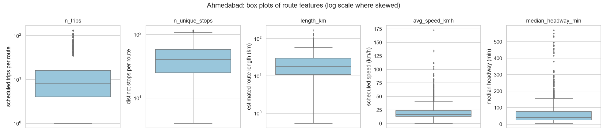
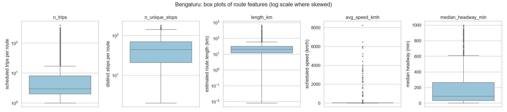
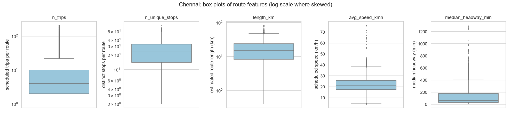
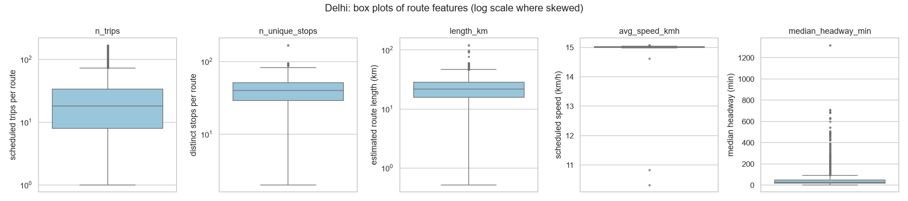
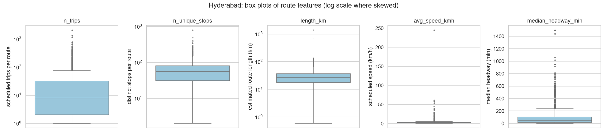
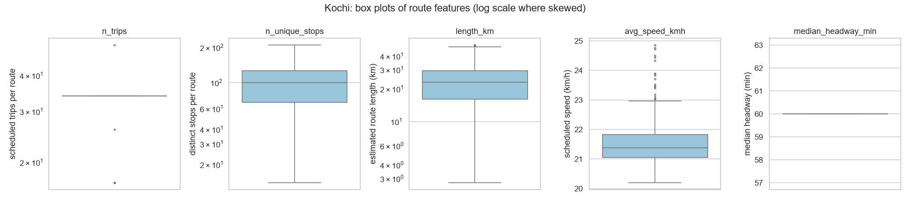
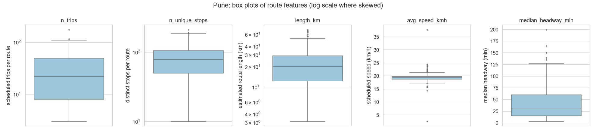

# Module 3 - Data quality summary

_Generated 2026-10-25._ Unusual values were **investigated, not deleted**. Original GTFS files stay in `data/raw/`; the Module-2 dataset is unchanged by this module (no corrections or exclusions were applied).
Outliers are statistical (Tukey fences) and are classified as: *valid but unusual*, *suspect* (contradicts other attributes of the route) or *source limitation* (property of the feed).

## Ahmedabad

* Dataset: 972 routes x 48 features; duplicate rows 0; duplicate route_id 0.
* Missing values: `median_headway_min` 94 (9.7%), `length_km_shape` 972 (100.0%) (undefined values, not zeros).

**Outlier screening (Tukey 1.5 x IQR, log scale for skewed features):**

| feature | min | median | max | n_low_outliers | n_high_outliers | outliers_pct |
|---|---|---|---|---|---|---|
| n_trips | 1.00 | 8.00 | 134.00 | 0 | 8 | 0.80 |
| n_unique_stops | 4.00 | 40.00 | 117.00 | 10 | 0 | 1.00 |
| length_km | 0.53 | 17.79 | 170.59 | 1 | 10 | 1.10 |
| service_span_h | 0.00 | 10.49 | 17.33 | 0 | 0 | 0.00 |
| median_headway_min | 5.00 | 40.00 | 571.00 | 0 | 18 | 2.10 |
| avg_speed_kmh | 0.35 | 16.88 | 172.96 | 0 | 120 | 12.30 |

**Investigation of unusual values (kept in the data; classified, not deleted):**

| check | routes | pct | reading |
|---|---|---|---|
| scheduled speed < 3 or > 80 km/h | 27 | 2.80 | suspect: length, duration or both look wrong for these routes (check publisher / shape); flagged, not deleted |
| very long routes (> Q3 + 3 IQR) | 33 | 3.40 | 25 of them have a plausible scheduled speed -> valid but unusual (long-distance routes); 8 do not -> suspect |
| very many scheduled trips (> Q3 + 3 IQR) | 61 | 6.30 | 0 combine several service patterns (counts add up alternative timetables); the rest are valid high-frequency routes or a feed property |
| routes with fewer than 3 scheduled trips | 174 | 17.90 | valid but sparse; headway undefined for many; NOT evidence of inefficiency |
| missing median headway (single departure time) | 94 | 9.70 | undefined, not zero; kept missing |

*Box plots used to investigate unusual values (trips, stops, length, scheduled speed, headway). Unusual values are investigated in the data-quality summary, not deleted.*

## Bengaluru

* Dataset: 4,416 routes x 48 features; duplicate rows 0; duplicate route_id 0.
* Missing values: `median_headway_min` 1043 (23.6%), `overlap_partner` 14 (0.3%), `overlap_partner_name` 14 (0.3%) (undefined values, not zeros).

**Outlier screening (Tukey 1.5 x IQR, log scale for skewed features):**

| feature | min | median | max | n_low_outliers | n_high_outliers | outliers_pct |
|---|---|---|---|---|---|---|
| n_trips | 1.00 | 3.00 | 398.00 | 0 | 312 | 7.10 |
| n_unique_stops | 2.00 | 44.00 | 184.00 | 389 | 0 | 8.80 |
| length_km | 0.01 | 19.79 | 688.78 | 140 | 42 | 4.10 |
| service_span_h | 0.00 | 8.67 | 23.77 | 0 | 0 | 0.00 |
| median_headway_min | 1.00 | 90.00 | 1,000.00 | 0 | 0 | 0.00 |
| avg_speed_kmh | 0.03 | 18.56 | 8,265.37 | 88 | 231 | 7.20 |

**Investigation of unusual values (kept in the data; classified, not deleted):**

| check | routes | pct | reading |
|---|---|---|---|
| scheduled speed < 3 or > 80 km/h | 93 | 2.10 | suspect: length, duration or both look wrong for these routes (check publisher / shape); flagged, not deleted |
| very long routes (> Q3 + 3 IQR) | 50 | 1.10 | 12 of them have a plausible scheduled speed -> valid but unusual (long-distance routes); 38 do not -> suspect |
| very many scheduled trips (> Q3 + 3 IQR) | 460 | 10.40 | 0 combine several service patterns (counts add up alternative timetables); the rest are valid high-frequency routes or a feed property |
| routes with fewer than 3 scheduled trips | 2082 | 47.10 | valid but sparse; headway undefined for many; NOT evidence of inefficiency |
| missing median headway (single departure time) | 1043 | 23.60 | undefined, not zero; kept missing |

*Box plots used to investigate unusual values (trips, stops, length, scheduled speed, headway). Unusual values are investigated in the data-quality summary, not deleted.*

## Chennai

* Dataset: 3,934 routes x 48 features; duplicate rows 0; duplicate route_id 0.
* Missing values: `median_headway_min` 869 (22.1%), `length_km_shape` 3934 (100.0%), `overlap_partner` 1 (0.0%), `overlap_partner_name` 1 (0.0%) (undefined values, not zeros).

**Outlier screening (Tukey 1.5 x IQR, log scale for skewed features):**

| feature | min | median | max | n_low_outliers | n_high_outliers | outliers_pct |
|---|---|---|---|---|---|---|
| n_trips | 1.00 | 4.00 | 210.00 | 0 | 126 | 3.20 |
| n_unique_stops | 2.00 | 23.00 | 80.00 | 134 | 0 | 3.40 |
| length_km | 0.40 | 15.43 | 83.42 | 50 | 0 | 1.30 |
| service_span_h | 0.00 | 8.83 | 23.92 | 0 | 0 | 0.00 |
| median_headway_min | 5.00 | 65.00 | 1,305.00 | 0 | 0 | 0.00 |
| avg_speed_kmh | 4.28 | 21.48 | 76.20 | 7 | 99 | 2.70 |

**Investigation of unusual values (kept in the data; classified, not deleted):**

| check | routes | pct | reading |
|---|---|---|---|
| scheduled speed < 3 or > 80 km/h | 0 | 0.00 | suspect: length, duration or both look wrong for these routes (check publisher / shape); flagged, not deleted |
| very long routes (> Q3 + 3 IQR) | 2 | 0.10 | 2 of them have a plausible scheduled speed -> valid but unusual (long-distance routes); 0 do not -> suspect |
| very many scheduled trips (> Q3 + 3 IQR) | 356 | 9.00 | 0 combine several service patterns (counts add up alternative timetables); the rest are valid high-frequency routes or a feed property |
| routes with fewer than 3 scheduled trips | 1558 | 39.60 | valid but sparse; headway undefined for many; NOT evidence of inefficiency |
| missing median headway (single departure time) | 869 | 22.10 | undefined, not zero; kept missing |

*Box plots used to investigate unusual values (trips, stops, length, scheduled speed, headway). Unusual values are investigated in the data-quality summary, not deleted.*

## Delhi

* Dataset: 2,964 routes x 47 features; duplicate rows 0; duplicate route_id 0.
* Missing values: `median_headway_min` 96 (3.2%), `length_km_shape` 2964 (100.0%) (undefined values, not zeros).
* **Feed-level caveat (source limitation):** Scheduled speed is almost identical on all routes (10th-90th percentile 15.0-15.0 km/h), suggesting generated rather than operational stop times; durations and headways should be read as a model schedule.

**Outlier screening (Tukey 1.5 x IQR, log scale for skewed features):**

| feature | min | median | max | n_low_outliers | n_high_outliers | outliers_pct |
|---|---|---|---|---|---|---|
| n_trips | 1.00 | 18.00 | 170.00 | 0 | 0 | 0.00 |
| n_unique_stops | 2.00 | 40.00 | 169.00 | 158 | 2 | 5.40 |
| length_km | 0.52 | 21.82 | 121.35 | 152 | 7 | 5.40 |
| service_span_h | 0.00 | 13.33 | 23.98 | 0 | 0 | 0.00 |
| median_headway_min | 2.00 | 27.00 | 1,320.00 | 6 | 143 | 5.20 |
| avg_speed_kmh | 10.32 | 15.01 | 15.08 | 3 | 15 | 0.60 |

**Investigation of unusual values (kept in the data; classified, not deleted):**

| check | routes | pct | reading |
|---|---|---|---|
| scheduled speed < 3 or > 80 km/h | 0 | 0.00 | suspect: length, duration or both look wrong for these routes (check publisher / shape); flagged, not deleted |
| very long routes (> Q3 + 3 IQR) | 7 | 0.20 | 7 of them have a plausible scheduled speed -> valid but unusual (long-distance routes); 0 do not -> suspect |
| very many scheduled trips (> Q3 + 3 IQR) | 67 | 2.30 | 0 combine several service patterns (counts add up alternative timetables); the rest are valid high-frequency routes or a feed property |
| routes with fewer than 3 scheduled trips | 205 | 6.90 | valid but sparse; headway undefined for many; NOT evidence of inefficiency |
| missing median headway (single departure time) | 96 | 3.20 | undefined, not zero; kept missing |

*Box plots used to investigate unusual values (trips, stops, length, scheduled speed, headway). Unusual values are investigated in the data-quality summary, not deleted.*

## Hyderabad

* Dataset: 1,031 routes x 48 features; duplicate rows 0; duplicate route_id 0.
* Missing values: `median_headway_min` 145 (14.1%), `length_km_shape` 1031 (100.0%) (undefined values, not zeros).
* **Feed-level caveat (source limitation):** 71% of routes have a median scheduled trip longer than 8 hours: the feed's 'trips' appear to be whole vehicle duties, so trip counts and headways are NOT comparable with cities whose trips are single runs.

**Outlier screening (Tukey 1.5 x IQR, log scale for skewed features):**

| feature | min | median | max | n_low_outliers | n_high_outliers | outliers_pct |
|---|---|---|---|---|---|---|
| n_trips | 1.00 | 8.00 | 2,087.00 | 0 | 2 | 0.20 |
| n_unique_stops | 2.00 | 55.00 | 795.00 | 19 | 6 | 2.40 |
| length_km | 0.59 | 26.45 | 1,390.70 | 20 | 7 | 2.60 |
| service_span_h | 0.00 | 12.70 | 80.25 | 0 | 9 | 0.90 |
| median_headway_min | 2.00 | 50.00 | 1,500.00 | 0 | 6 | 0.70 |
| avg_speed_kmh | 0.56 | 1.83 | 245.14 | 0 | 111 | 10.80 |

**Investigation of unusual values (kept in the data; classified, not deleted):**

| check | routes | pct | reading |
|---|---|---|---|
| scheduled speed < 3 or > 80 km/h | 778 | 75.50 | suspect: length, duration or both look wrong for these routes (check publisher / shape); flagged, not deleted |
| very long routes (> Q3 + 3 IQR) | 13 | 1.30 | 10 of them have a plausible scheduled speed -> valid but unusual (long-distance routes); 3 do not -> suspect |
| very many scheduled trips (> Q3 + 3 IQR) | 97 | 9.40 | 0 combine several service patterns (counts add up alternative timetables); the rest are valid high-frequency routes or a feed property |
| routes with fewer than 3 scheduled trips | 269 | 26.10 | valid but sparse; headway undefined for many; NOT evidence of inefficiency |
| missing median headway (single departure time) | 145 | 14.10 | undefined, not zero; kept missing |

*Box plots used to investigate unusual values (trips, stops, length, scheduled speed, headway). Unusual values are investigated in the data-quality summary, not deleted.*

## Kochi

* Dataset: 465 routes x 48 features; duplicate rows 0; duplicate route_id 0.
* Missing values: none (undefined values, not zeros).
* **Feed-level caveat (source limitation):** Scheduled speed is almost identical on all routes (10th-90th percentile 20.8-22.4 km/h), suggesting generated rather than operational stop times; durations and headways should be read as a model schedule.
* **Feed-level caveat (source limitation):** Trip counts come from expanding frequency templates (a bus every N minutes), so routes look uniform because the publisher used a uniform pattern; this is not measured service.

**Outlier screening (Tukey 1.5 x IQR, log scale for skewed features):**

| feature | min | median | max | n_low_outliers | n_high_outliers | outliers_pct |
|---|---|---|---|---|---|---|
| n_trips | 17.00 | 34.00 | 51.00 | 15 | 1 | 3.40 |
| n_unique_stops | 14.00 | 100.00 | 210.00 | 11 | 0 | 2.40 |
| length_km | 2.75 | 23.18 | 50.57 | 17 | 0 | 3.70 |
| service_span_h | 13.50 | 16.00 | 16.00 | 1 | 0 | 0.20 |
| median_headway_min | 60.00 | 60.00 | 60.00 | 0 | 0 | 0.00 |
| avg_speed_kmh | 20.20 | 21.37 | 24.85 | 0 | 18 | 3.90 |

**Investigation of unusual values (kept in the data; classified, not deleted):**

| check | routes | pct | reading |
|---|---|---|---|
| scheduled speed < 3 or > 80 km/h | 0 | 0.00 | suspect: length, duration or both look wrong for these routes (check publisher / shape); flagged, not deleted |
| very long routes (> Q3 + 3 IQR) | 0 | 0.00 | 0 of them have a plausible scheduled speed -> valid but unusual (long-distance routes); 0 do not -> suspect |
| very many scheduled trips (> Q3 + 3 IQR) | 1 | 0.20 | 0 combine several service patterns (counts add up alternative timetables); the rest are valid high-frequency routes or a feed property |
| routes with fewer than 3 scheduled trips | 0 | 0.00 | valid but sparse; headway undefined for many; NOT evidence of inefficiency |
| missing median headway (single departure time) | 0 | 0.00 | undefined, not zero; kept missing |

*Box plots used to investigate unusual values (trips, stops, length, scheduled speed, headway). Unusual values are investigated in the data-quality summary, not deleted.*

## Pune

* Dataset: 315 routes x 48 features; duplicate rows 0; duplicate route_id 0.
* Missing values: none (undefined values, not zeros).
* **Feed-level caveat (source limitation):** Scheduled speed is almost identical on all routes (10th-90th percentile 18.2-20.6 km/h), suggesting generated rather than operational stop times; durations and headways should be read as a model schedule.

**Outlier screening (Tukey 1.5 x IQR, log scale for skewed features):**

| feature | min | median | max | n_low_outliers | n_high_outliers | outliers_pct |
|---|---|---|---|---|---|---|
| n_trips | 3.00 | 22.00 | 175.00 | 0 | 0 | 0.00 |
| n_unique_stops | 10.00 | 79.00 | 212.00 | 1 | 0 | 0.30 |
| length_km | 3.11 | 19.99 | 70.70 | 0 | 0 | 0.00 |
| service_span_h | 3.08 | 9.42 | 23.50 | 0 | 6 | 1.90 |
| median_headway_min | 3.00 | 30.00 | 200.00 | 0 | 0 | 0.00 |
| avg_speed_kmh | 2.52 | 19.36 | 37.82 | 9 | 18 | 8.60 |

**Investigation of unusual values (kept in the data; classified, not deleted):**

| check | routes | pct | reading |
|---|---|---|---|
| scheduled speed < 3 or > 80 km/h | 2 | 0.60 | suspect: length, duration or both look wrong for these routes (check publisher / shape); flagged, not deleted |
| very long routes (> Q3 + 3 IQR) | 0 | 0.00 | 0 of them have a plausible scheduled speed -> valid but unusual (long-distance routes); 0 do not -> suspect |
| very many scheduled trips (> Q3 + 3 IQR) | 1 | 0.30 | 0 combine several service patterns (counts add up alternative timetables); the rest are valid high-frequency routes or a feed property |
| routes with fewer than 3 scheduled trips | 0 | 0.00 | valid but sparse; headway undefined for many; NOT evidence of inefficiency |
| missing median headway (single departure time) | 0 | 0.00 | undefined, not zero; kept missing |

*Box plots used to investigate unusual values (trips, stops, length, scheduled speed, headway). Unusual values are investigated in the data-quality summary, not deleted.*
