# Module 3 - Exploratory analysis report

_Generated 2026-10-25._ Data: the feature-engineered dataset from Module 2 (`data/processed/<city>/route_features.csv`, `route_hour_features.csv`, `stop_usage.csv`) for 7 cities.

> **What this report describes.** GTFS contains the *planned* routes, trips, stops and times. Every number below is a count of **scheduled** trips or stops. It is not a count of passengers: GTFS has no ridership or occupancy data, so no route is called overcrowded or underutilised here. Routes that look different are *candidates for further investigation*, nothing more.

## Cross-city summary

| city | routes | scheduled_trips | stops | median_trips_per_route | p90_trips | max_over_median | share_routes_le5_trips | median_stops | median_length_km | busiest_hour | quietest_hour | busiest_period_per_hour | rho_length_trips | rho_stops_trips | overlap_pairs_ge80 | routes_speed_flagged |
|---|---|---|---|---|---|---|---|---|---|---|---|---|---|---|---|---|
| ahmedabad | 972 | 14323 | 3235 | 8.00 | 37.90 | 16.80 | 40% | 40.00 | 17.80 | 07:00 | 00:00 | afternoon | 0.14 | 0.16 | 117 | 27 |
| bengaluru | 4416 | 57836 | 9948 | 3.00 | 28.50 | 132.70 | 66% | 44.00 | 19.80 | 08:00 | 02:00 | afternoon | 0.04 | 0.33 | 1048 | 93 |
| chennai | 3934 | 47047 | 5477 | 4.00 | 30.00 | 52.50 | 61% | 23.00 | 15.40 | 14:00 | 02:00 | afternoon | 0.12 | 0.20 | 1118 | 0 |
| delhi | 2964 | 78507 | 6267 | 18.00 | 62.00 | 9.40 | 17% | 40.00 | 21.80 | 07:00 | 02:00 | afternoon | 0.03 | 0.10 | 222 | 0 |
| hyderabad | 1031 | 44892 | 5028 | 8.00 | 117.00 | 260.90 | 44% | 55.00 | 26.40 | 07:00 | 01:00 | afternoon | 0.10 | 0.58 | 99 | 778 |
| kochi | 465 | 15581 | 3228 | 34.00 | 34.00 | 1.50 | 0% | 100.00 | 23.20 | 06:00 | 00:00 | morning | -0.01 | 0.18 | 114 | 0 |
| pune | 315 | 10128 | 6745 | 22.00 | 77.00 | 8.00 | 14% | 79.00 | 20.00 | 08:00 | 23:00 | morning | -0.13 | -0.17 | 8 | 2 |

## Answers to the guiding questions

1. **Hours with the highest / lowest scheduled trip counts** - busiest hour per city: ahmedabad 07:00, bengaluru 08:00, chennai 14:00, delhi 07:00, hyderabad 07:00, kochi 06:00, pune 08:00; quietest: ahmedabad 00:00, bengaluru 02:00, chennai 02:00, delhi 02:00, hyderabad 01:00, kochi 00:00, pune 23:00. Busiest period per hour: ahmedabad afternoon, bengaluru afternoon, chennai afternoon, delhi afternoon, hyderabad afternoon, kochi morning, pune morning.
2. **How service varies across routes** - scheduled trips per route are very unevenly spread: ahmedabad median 8, max 17x median, 40% of routes <= 5 trips, bengaluru median 3, max 133x median, 66% of routes <= 5 trips, chennai median 4, max 52x median, 61% of routes <= 5 trips, delhi median 18, max 9x median, 17% of routes <= 5 trips, hyderabad median 8, max 261x median, 44% of routes <= 5 trips, kochi median 34, max 2x median, 0% of routes <= 5 trips, pune median 22, max 8x median, 14% of routes <= 5 trips.
3. **Routes with the most distinct stops** - listed per city in section 4 below.
4. **Route length vs scheduled trips** - Spearman rho: ahmedabad 0.14, bengaluru 0.04, chennai 0.12, delhi 0.03, hyderabad 0.10, kochi -0.01, pune -0.13. Values near 0 mean the two vary almost independently; this is an association, not a cause.
5. **Shared stops / geographical segments** - route pairs with >= 80% shared stops: ahmedabad 117, bengaluru 1048, chennai 1118, delhi 222, hyderabad 99, kochi 114, pune 8. Path-based overlap (shapes.txt) was computed only where bus shapes exist: bengaluru 1628 routes, kochi 219 routes, pune 18 routes.
6. **Unusual values and quality issues** - see `module3_data_quality_summary.md`: very uneven trip counts, implausible scheduled speeds in some routes, undefined headways for single-departure routes, and feed-level caveats (Hyderabad duty-level trips, Delhi/Kochi/Pune near-constant speeds, expired Delhi/Kochi calendars).
7. **What the data supports and what it does not** - supported: how many trips and stops each route has, when scheduled service is concentrated, which routes share stops or corridors. Not supported: any statement about crowding, passenger demand, profitability, or whether a route should be merged or cut. That needs ridership/boarding counts by route and time, vehicle capacity and fleet data, run-time or delay data, and the operator's service objectives (see `module3_findings_and_limitations.md`).

---
## Ahmedabad

### 1. Dataset inspection

* 972 rows x 48 columns (one row per route); duplicate rows: 0; duplicate route_id: 0.
* Columns with missing values: `median_headway_min` (94), `length_km_shape` (972) (missing = undefined/unknown, never replaced by zero).

Summary statistics of the main numeric features:

| feature | count | min | median | mean | std | max | p90 |
|---|---|---|---|---|---|---|---|
| n_trips | 972.00 | 1.00 | 8.00 | 14.74 | 20.35 | 134.00 | 37.90 |
| n_unique_stops | 972.00 | 4.00 | 40.00 | 43.07 | 22.33 | 117.00 | 74.00 |
| length_km | 972.00 | 0.53 | 17.79 | 27.25 | 25.90 | 170.59 | 66.73 |
| service_span_h | 972.00 | 0.00 | 10.49 | 8.81 | 5.51 | 17.33 | 15.50 |
| median_headway_min | 878.00 | 5.00 | 40.00 | 72.08 | 86.14 | 571.00 | 165.00 |
| avg_trip_duration_min | 972.00 | 8.00 | 63.09 | 82.30 | 181.21 | 3,072.14 | 115.00 |
| trips_per_active_hour | 972.00 | 1.00 | 1.25 | 1.69 | 1.10 | 7.88 | 2.94 |
| stops_per_km | 972.00 | 0.19 | 2.14 | 2.18 | 0.98 | 7.48 | 3.41 |
| avg_speed_kmh | 972.00 | 0.35 | 16.88 | 23.30 | 17.87 | 172.96 | 46.10 |
| max_stop_overlap | 972.00 | 0.01 | 0.52 | 0.55 | 0.25 | 1.00 | 0.91 |
| mean_routes_per_stop | 972.00 | 2.38 | 38.86 | 40.39 | 18.58 | 114.00 | 65.06 |

### 2. Univariate analysis

* 972 routes in the dataset. Scheduled trips per route: median 8, mean 14.7, maximum 134 (17 times the median). 40% of routes have 5 or fewer scheduled trips and 7% have 50 or more, so service levels differ widely between routes.
* Distinct stops per route: median 40 (range 4-117).
* Estimated route length: median 17.8 km (middle half of routes 10.9-30.1 km). 0% of lengths come from shapes.txt; the rest are straight-line stop-to-stop distances, which understate road length.
* Scheduled service span (first to last departure): median 10.5 h; 34% of routes span 12 hours or more.
* Operating days: 100% of routes have the same number of scheduled trips on weekend days as on weekdays according to calendar.txt.

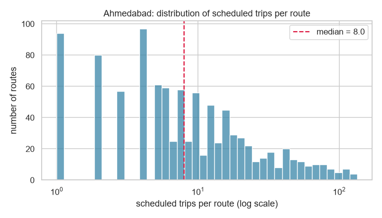

*Histogram of scheduled trips per route on a log scale. Each bar counts routes with that many trips; the dashed line is the median. A long right tail means a few routes have far more scheduled trips than most.*

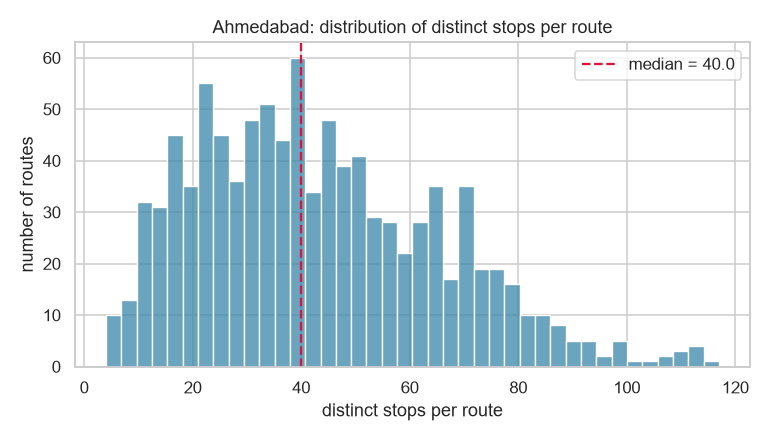

*Histogram of distinct stops per route. It shows whether most routes serve a similar number of stops or whether stop counts differ a lot.*

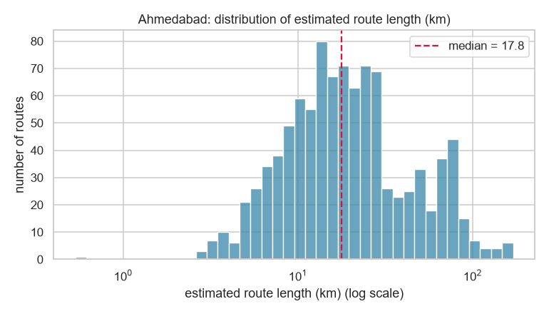

*Histogram of estimated route length (km, log scale). Lengths come from shapes.txt where available, otherwise from straight-line distances between stops.*

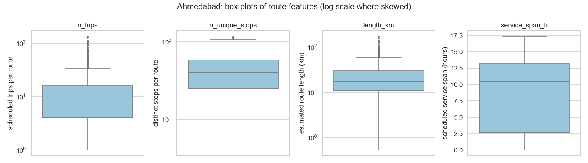

*Box plots of four route features (log scale where skewed): the box holds the middle 50% of routes, the line is the median and dots are statistical outliers (not necessarily errors).*

### 3. Scheduled service by time of day

* Hours with the most scheduled trip starts: 07:00 (1,072), 08:00 (1,055), 16:00 (945). Hours with the fewest: 00:00 (0), 01:00 (0), 02:00 (0). No trip starts at all in hours 00, 01, 02, 03, 04.
* By period: morning 40.6% of scheduled trips (830 per hour); afternoon 29.4% of scheduled trips (841 per hour); evening 23.2% of scheduled trips (831 per hour); night 6.8% of scheduled trips (123 per hour). The busiest period per hour is afternoon and the quietest is night. These are planned services, not passenger numbers; strong concentration in a few hours can also reflect how the publisher compiled the timetable, so it should be checked with the operator before it is read as a real service pattern.
* Weekday vs weekend: scheduled trips on a typical weekday (Wednesday services) 14,323; on Sunday 14,323 (100% of the weekday level). The calendar describes identical service on both days.

| period | hours | scheduled_trips | share_% | trips_per_hour |
|---|---|---|---|---|
| morning | 7 | 5812 | 40.60 | 830.00 |
| afternoon | 5 | 4207 | 29.40 | 841.00 |
| evening | 4 | 3323 | 23.20 | 831.00 |
| night | 8 | 981 | 6.80 | 123.00 |

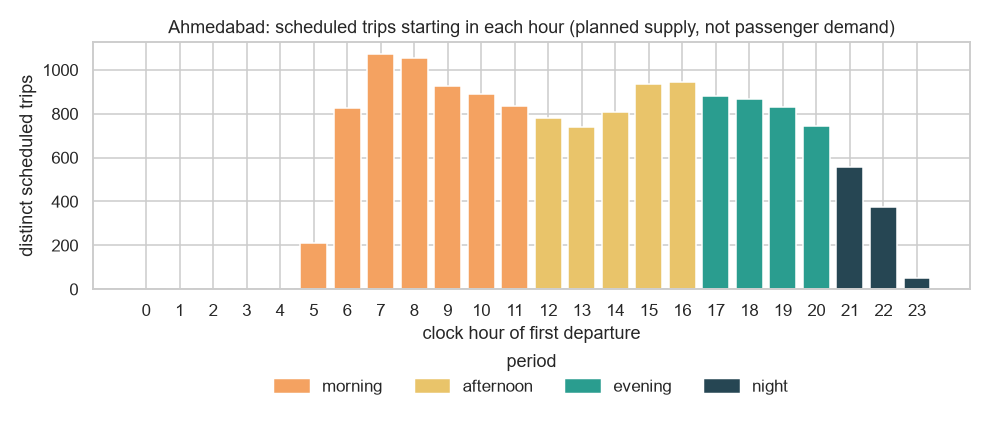

*Distinct scheduled trips whose first departure falls in each clock hour, coloured by time period. This is planned service supply; it is not passenger demand.*

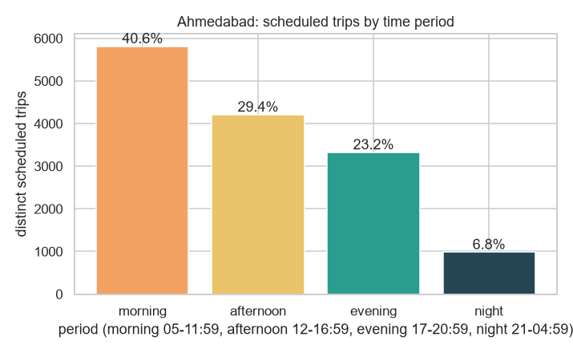

*Scheduled trips by time period with each period's share of all scheduled trips. Periods have different lengths in hours, so compare trips per hour (in the table) as well.*

### 4. Route-wise comparison

* Routes in the lowest quarter of scheduled trips (<= 2) have a median of 36 stops and 16.0 km; routes in the highest quarter (>= 30 trips) have 50 stops and 22.6 km.
* Median service span: 1.6 h (low-trip group) vs 15.0 h (high-trip group). It describes what the schedule looks like - not whether a route is efficient.
* Most stops on one route: 300 (117), 16 (114), 204 (114). Most scheduled trips: 9U-VM (134), 9D-MV (130), 1D (128).

| group (by scheduled trips) | routes | n_trips | n_unique_stops | length_km | service_span_h | median_headway_min | avg_speed_kmh | max_stop_overlap |
|---|---|---|---|---|---|---|---|---|
| low (<= Q1) | 328 | 2.00 | 36.00 | 16.04 | 1.58 | 80.00 | 17.16 | 0.54 |
| middle | 388 | 8.00 | 39.00 | 17.18 | 10.83 | 50.00 | 17.11 | 0.53 |
| high (>= Q3) | 256 | 30.00 | 50.00 | 22.60 | 15.00 | 20.00 | 15.95 | 0.49 |

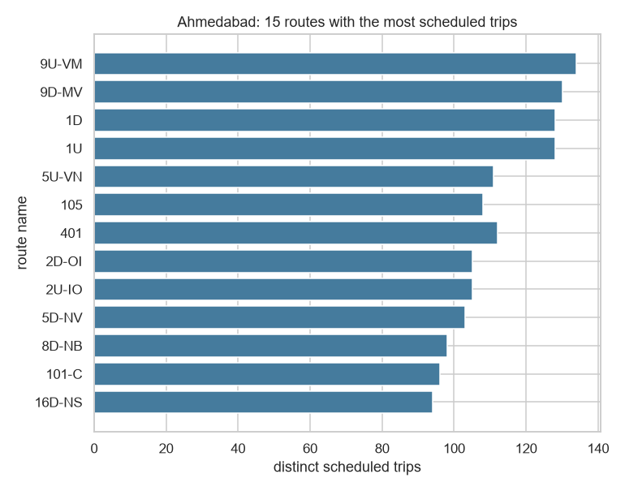

*The 15 routes with the most scheduled trips. High scheduled trip counts show where the timetable offers most departures; they do not show crowding.*

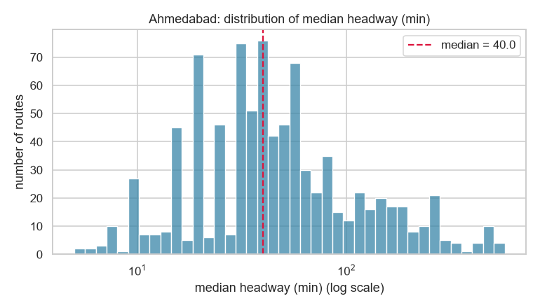

*Histogram of the median scheduled gap between consecutive departures of a route (headway, minutes, log scale). Routes with a single departure time have no headway and are not shown.*

### 5. Geographical analysis and overlap

* Stop map: `maps/ahmedabad_stops_heatmap.html` (heat map of the 3,235 stops weighted by the number of routes calling there; the 15 stops with most routes are marked).
* **No usable route-shape data for buses in this feed**, so route paths are not drawn and path-based overlap is not computed (stop-based overlap only).
* Stop-based overlap (Jaccard similarity of the stop sets of two routes): 203 routes have a partner with >= 80% similar stops, 511 with >= 50% (117 distinct pairs at >= 80%). Same-name routes and opposite-direction twins are excluded. Sharing stops does not prove that two routes are redundant.

Most similar route pairs by shared stops (candidates for further investigation, not conclusions):

| route_name | overlap_partner_name | max_stop_overlap | n_trips | partner_trips | length_km |
|---|---|---|---|---|---|
| 117 | 28 | 1.00 | 1 | 16 | 6.16 |
| 123 | 37sh | 1.00 | 10 | 1 | 5.06 |
| 123 | 123sh | 1.00 | 3 | 60 | 27.95 |
| 142sh | 142 | 1.00 | 60 | 5 | 12.12 |
| 142sh | 142 | 1.00 | 70 | 5 | 12.12 |
| 204 | 205 | 1.00 | 8 | 8 | 75.16 |
| 151sh | 151 | 1.00 | 6 | 8 | 16.61 |
| 151sh | 151 | 1.00 | 6 | 8 | 16.61 |

### 6. Association between features

* length_km vs n_trips: Spearman rho = 0.14 -> almost no association (the two vary almost independently).
* n_unique_stops vs n_trips: Spearman rho = 0.16 -> almost no association (the two vary almost independently).
* length_km vs n_unique_stops: Spearman rho = 0.77 -> a strong association (longer/larger routes tend to have higher values of both).
* length_km vs median_headway_min: Spearman rho = 0.16 -> almost no association (the two vary almost independently).

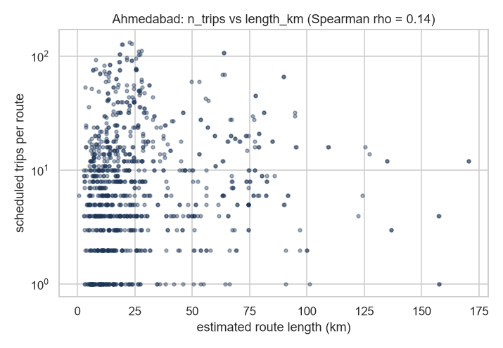

*Each dot is a route: estimated length against scheduled trips (log scale). The Spearman rho in the title measures how consistently they rise or fall together - an association, not a cause.*

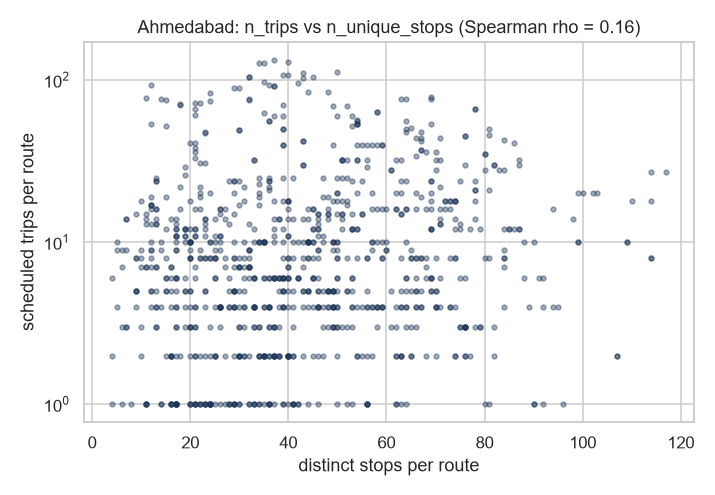

*Distinct stops against scheduled trips for each route; rho in the title as above.*

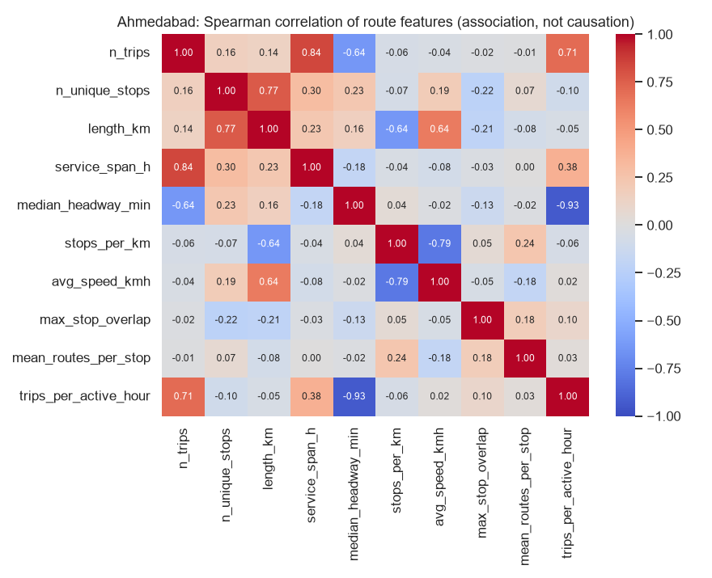

*Spearman correlation matrix of numeric route features. Colour shows the direction and strength of association between two features; identifiers are not included. Some pairs (scheduled trips, trips per active hour, headway, service span) are linked by definition, so their high correlation is expected and is not a finding.*

Correlation shows association only; it does not show that longer routes cause more or fewer trips.

---
## Bengaluru

### 1. Dataset inspection

* 4,416 rows x 48 columns (one row per route); duplicate rows: 0; duplicate route_id: 0.
* Columns with missing values: `median_headway_min` (1043), `overlap_partner` (14), `overlap_partner_name` (14) (missing = undefined/unknown, never replaced by zero).

Summary statistics of the main numeric features:

| feature | count | min | median | mean | std | max | p90 |
|---|---|---|---|---|---|---|---|
| n_trips | 4,416.00 | 1.00 | 3.00 | 13.10 | 32.72 | 398.00 | 28.50 |
| n_unique_stops | 4,416.00 | 2.00 | 44.00 | 47.59 | 33.04 | 184.00 | 94.00 |
| length_km | 4,416.00 | 0.01 | 19.79 | 24.45 | 32.42 | 688.78 | 40.00 |
| service_span_h | 4,416.00 | 0.00 | 8.67 | 7.96 | 6.22 | 23.77 | 15.83 |
| median_headway_min | 3,373.00 | 1.00 | 90.00 | 181.31 | 211.27 | 1,000.00 | 530.00 |
| avg_trip_duration_min | 4,416.00 | 0.90 | 65.75 | 66.39 | 36.16 | 660.00 | 108.36 |
| trips_per_active_hour | 4,416.00 | 1.00 | 1.00 | 1.57 | 1.65 | 20.95 | 2.40 |
| stops_per_km | 4,416.00 | 0.04 | 2.38 | 2.27 | 1.08 | 10.00 | 3.53 |
| avg_speed_kmh | 4,416.00 | 0.03 | 18.56 | 47.40 | 332.45 | 8,265.37 | 26.51 |
| max_stop_overlap | 4,416.00 | 0.00 | 0.71 | 0.66 | 0.23 | 1.00 | 0.93 |
| mean_routes_per_stop | 4,416.00 | 1.00 | 84.34 | 87.93 | 53.98 | 354.00 | 159.42 |

### 2. Univariate analysis

* 4,416 routes in the dataset. Scheduled trips per route: median 3, mean 13.1, maximum 398 (133 times the median). 66% of routes have 5 or fewer scheduled trips and 7% have 50 or more, so service levels differ widely between routes.
* Distinct stops per route: median 44 (range 2-184).
* Estimated route length: median 19.8 km (middle half of routes 11.8-30.8 km). 99% of lengths come from shapes.txt; the rest are straight-line stop-to-stop distances, which understate road length.
* Scheduled service span (first to last departure): median 8.7 h; 32% of routes span 12 hours or more.
* Operating days: 100% of routes have the same number of scheduled trips on weekend days as on weekdays according to calendar.txt.

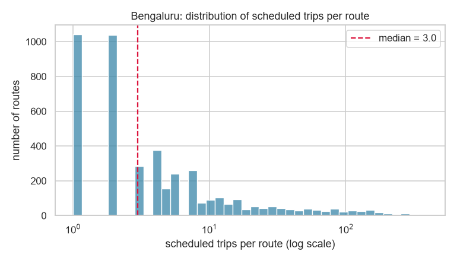

*Histogram of scheduled trips per route on a log scale. Each bar counts routes with that many trips; the dashed line is the median. A long right tail means a few routes have far more scheduled trips than most.*

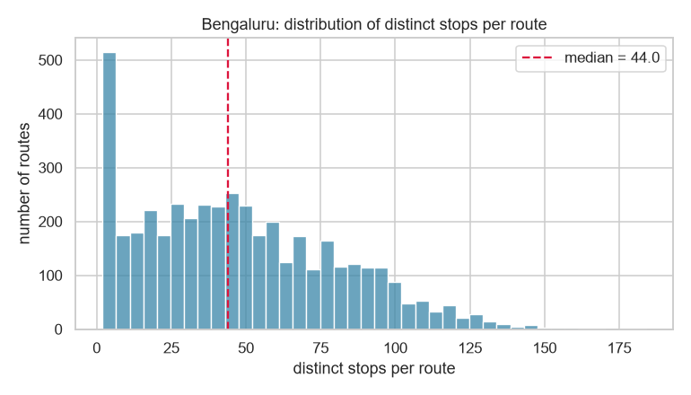

*Histogram of distinct stops per route. It shows whether most routes serve a similar number of stops or whether stop counts differ a lot.*

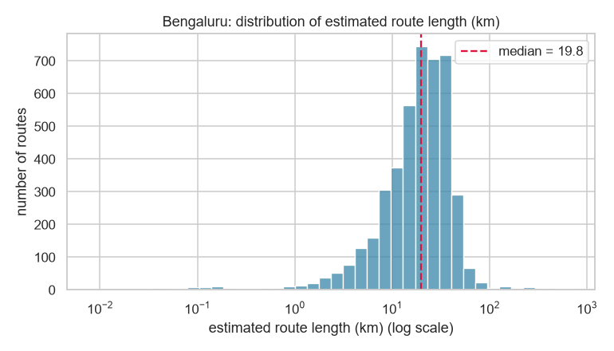

*Histogram of estimated route length (km, log scale). Lengths come from shapes.txt where available, otherwise from straight-line distances between stops.*

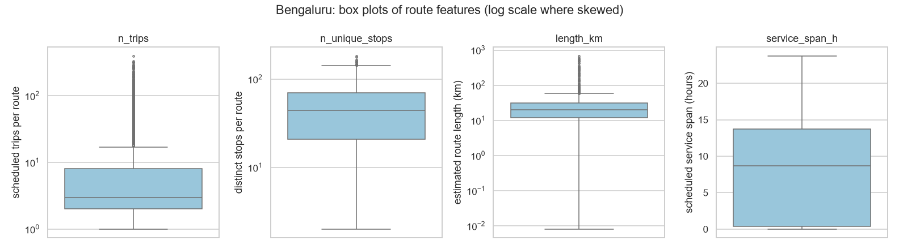

*Box plots of four route features (log scale where skewed): the box holds the middle 50% of routes, the line is the median and dots are statistical outliers (not necessarily errors).*

### 3. Scheduled service by time of day

* Hours with the most scheduled trip starts: 08:00 (4,504), 07:00 (4,115), 15:00 (4,029). Hours with the fewest: 02:00 (31), 00:00 (43), 01:00 (44).
* By period: morning 42.3% of scheduled trips (3,491 per hour); afternoon 31.5% of scheduled trips (3,638 per hour); evening 21.0% of scheduled trips (3,038 per hour); night 5.3% of scheduled trips (382 per hour). The busiest period per hour is afternoon and the quietest is night. These are planned services, not passenger numbers; strong concentration in a few hours can also reflect how the publisher compiled the timetable, so it should be checked with the operator before it is read as a real service pattern.
* Weekday vs weekend: scheduled trips on a typical weekday (Wednesday services) 57,836; on Sunday 57,836 (100% of the weekday level). The calendar describes identical service on both days.

| period | hours | scheduled_trips | share_% | trips_per_hour |
|---|---|---|---|---|
| morning | 7 | 24438 | 42.30 | 3,491.00 |
| afternoon | 5 | 18191 | 31.50 | 3,638.00 |
| evening | 4 | 12152 | 21.00 | 3,038.00 |
| night | 8 | 3055 | 5.30 | 382.00 |

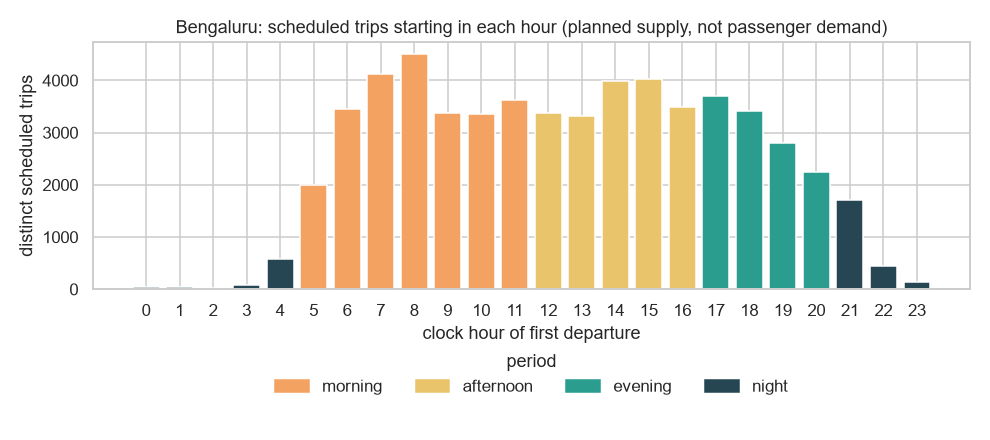

*Distinct scheduled trips whose first departure falls in each clock hour, coloured by time period. This is planned service supply; it is not passenger demand.*

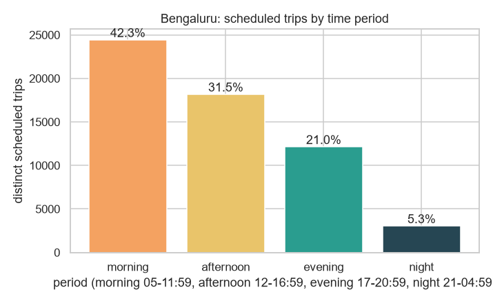

*Scheduled trips by time period with each period's share of all scheduled trips. Periods have different lengths in hours, so compare trips per hour (in the table) as well.*

### 4. Route-wise comparison

* Routes in the lowest quarter of scheduled trips (<= 1) have a median of 29 stops and 18.3 km; routes in the highest quarter (>= 18 trips) have 52 stops and 18.4 km.
* Median service span: 0.0 h (low-trip group) vs 15.0 h (high-trip group). A route with a single trip has a span of 0 by definition, so this difference is partly built in. It describes what the schedule looks like - not whether a route is efficient.
* Most stops on one route: 399-F D27G-ANK-HSK (184), 256-MB (178), 398-H D27G-HSK (166). Most scheduled trips: 375-D (398), 401-M (328), 378 (318).

| group (by scheduled trips) | routes | n_trips | n_unique_stops | length_km | service_span_h | median_headway_min | avg_speed_kmh | max_stop_overlap |
|---|---|---|---|---|---|---|---|---|
| low (<= Q1) | 2082 | 1.00 | 29.00 | 18.28 | 0.00 | 450.00 | 18.86 | 0.56 |
| middle | 1156 | 4.00 | 66.00 | 25.87 | 10.38 | 110.00 | 19.15 | 0.81 |
| high (>= Q3) | 1178 | 18.00 | 52.00 | 18.44 | 15.00 | 30.00 | 17.39 | 0.79 |

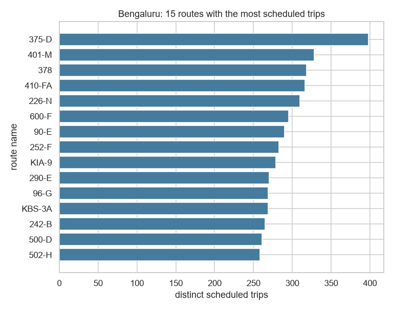

*The 15 routes with the most scheduled trips. High scheduled trip counts show where the timetable offers most departures; they do not show crowding.*

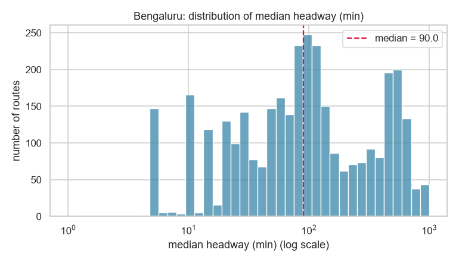

*Histogram of the median scheduled gap between consecutive departures of a route (headway, minutes, log scale). Routes with a single departure time have no headway and are not shown.*

### 5. Geographical analysis and overlap

* Stop map: `maps/bengaluru_stops_heatmap.html` (heat map of the 9,948 stops weighted by the number of routes calling there; the 15 stops with most routes are marked).
* Route shapes available for 99% of routes: `maps/bengaluru_top_route_shapes.html`, `maps/bengaluru_shape_overlap_pair.html`.
* Stop-based overlap (Jaccard similarity of the stop sets of two routes): 1639 routes have a partner with >= 80% similar stops, 3247 with >= 50% (1048 distinct pairs at >= 80%). Same-name routes and opposite-direction twins are excluded. Sharing stops does not prove that two routes are redundant.
* Path-based overlap from shapes.txt (~200 m grid cells): 1628 routes share >= 80% of their corridor with another route, 3712 share >= 50%.

Most similar route pairs by shared stops (candidates for further investigation, not conclusions):

| route_name | overlap_partner_name | max_stop_overlap | n_trips | partner_trips | length_km |
|---|---|---|---|---|---|
| 300-MV | V-300MV | 1.00 | 227 | 167 | 11.95 |
| STJHS-4 | STJHS-1 | 1.00 | 2 | 2 | 5.12 |
| KSRTC-MYSORE H EXPRESS-1 | V-KSRTC MYSORE EXP-1 | 1.00 | 8 | 14 | 137.00 |
| KSRTC-DAVANAGERE-1 | V-KSRTC DAVANAGERE-1 | 1.00 | 8 | 14 | 263.18 |
| BEML-33B | BEML-33C | 1.00 | 2 | 2 | 7.35 |
| SCS-6 | SCS-1 | 1.00 | 2 | 2 | 4.86 |
| DSC-4 | DSIT-2A | 1.00 | 3 | 2 | 11.84 |
| CHLS-5 | CRST-5A | 1.00 | 2 | 2 | 13.04 |

### 6. Association between features

* length_km vs n_trips: Spearman rho = 0.04 -> almost no association (the two vary almost independently).
* n_unique_stops vs n_trips: Spearman rho = 0.33 -> a weak association (longer/larger routes tend to have higher values of both).
* length_km vs n_unique_stops: Spearman rho = 0.75 -> a strong association (longer/larger routes tend to have higher values of both).
* length_km vs median_headway_min: Spearman rho = 0.09 -> almost no association (the two vary almost independently).

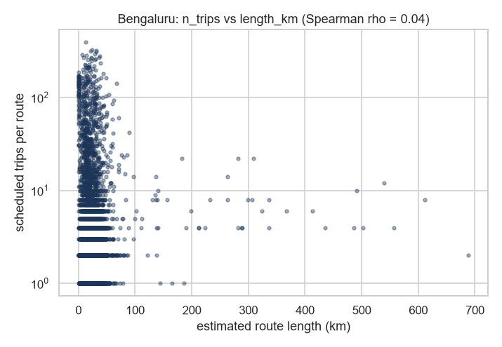

*Each dot is a route: estimated length against scheduled trips (log scale). The Spearman rho in the title measures how consistently they rise or fall together - an association, not a cause.*

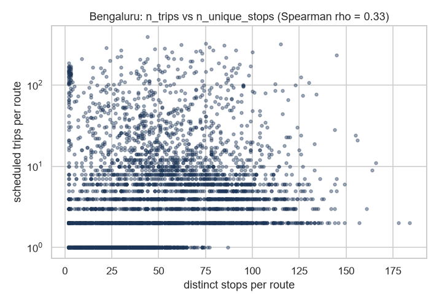

*Distinct stops against scheduled trips for each route; rho in the title as above.*

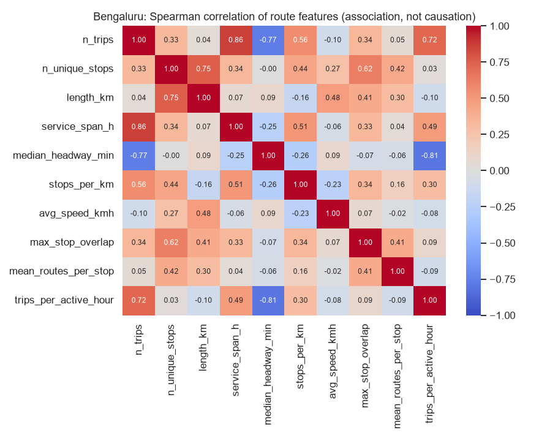

*Spearman correlation matrix of numeric route features. Colour shows the direction and strength of association between two features; identifiers are not included. Some pairs (scheduled trips, trips per active hour, headway, service span) are linked by definition, so their high correlation is expected and is not a finding.*

Correlation shows association only; it does not show that longer routes cause more or fewer trips.

---
## Chennai

### 1. Dataset inspection

* 3,934 rows x 48 columns (one row per route); duplicate rows: 0; duplicate route_id: 0.
* Columns with missing values: `median_headway_min` (869), `length_km_shape` (3934), `overlap_partner` (1), `overlap_partner_name` (1) (missing = undefined/unknown, never replaced by zero).

Summary statistics of the main numeric features:

| feature | count | min | median | mean | std | max | p90 |
|---|---|---|---|---|---|---|---|
| n_trips | 3,934.00 | 1.00 | 4.00 | 11.96 | 23.63 | 210.00 | 30.00 |
| n_unique_stops | 3,934.00 | 2.00 | 23.00 | 24.41 | 13.68 | 80.00 | 43.00 |
| length_km | 3,934.00 | 0.40 | 15.43 | 17.28 | 11.42 | 83.42 | 33.07 |
| service_span_h | 3,934.00 | 0.00 | 8.83 | 8.05 | 6.48 | 23.92 | 15.99 |
| median_headway_min | 3,065.00 | 5.00 | 65.00 | 144.28 | 179.40 | 1,305.00 | 489.20 |
| avg_trip_duration_min | 3,934.00 | 2.00 | 43.00 | 45.92 | 27.46 | 269.00 | 80.70 |
| trips_per_active_hour | 3,934.00 | 1.00 | 1.00 | 1.49 | 1.10 | 12.24 | 2.47 |
| stops_per_km | 3,934.00 | 0.08 | 1.54 | 1.64 | 0.63 | 6.00 | 2.41 |
| avg_speed_kmh | 3,934.00 | 4.28 | 21.48 | 22.28 | 7.08 | 76.20 | 31.21 |
| max_stop_overlap | 3,934.00 | 0.00 | 0.76 | 0.72 | 0.23 | 1.00 | 1.00 |
| mean_routes_per_stop | 3,934.00 | 1.00 | 59.54 | 65.96 | 38.16 | 364.50 | 111.80 |

### 2. Univariate analysis

* 3,934 routes in the dataset. Scheduled trips per route: median 4, mean 12.0, maximum 210 (52 times the median). 61% of routes have 5 or fewer scheduled trips and 6% have 50 or more, so service levels differ widely between routes.
* Distinct stops per route: median 23 (range 2-80).
* Estimated route length: median 15.4 km (middle half of routes 8.3-24.1 km). 0% of lengths come from shapes.txt; the rest are straight-line stop-to-stop distances, which understate road length.
* Scheduled service span (first to last departure): median 8.8 h; 34% of routes span 12 hours or more.
* Operating days: 100% of routes have the same number of scheduled trips on weekend days as on weekdays according to calendar.txt.

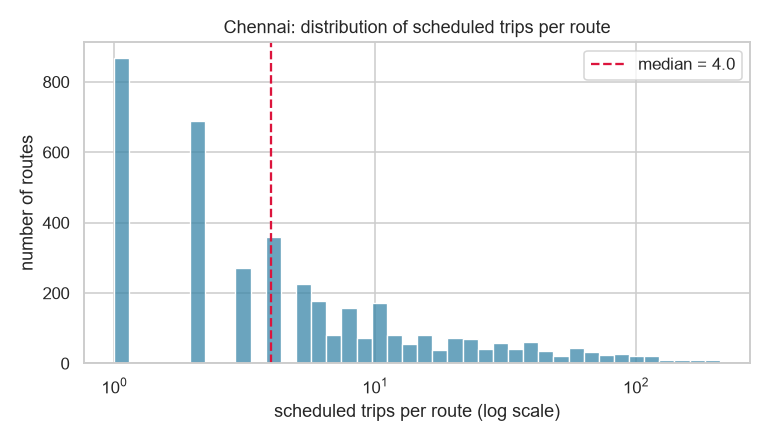

*Histogram of scheduled trips per route on a log scale. Each bar counts routes with that many trips; the dashed line is the median. A long right tail means a few routes have far more scheduled trips than most.*

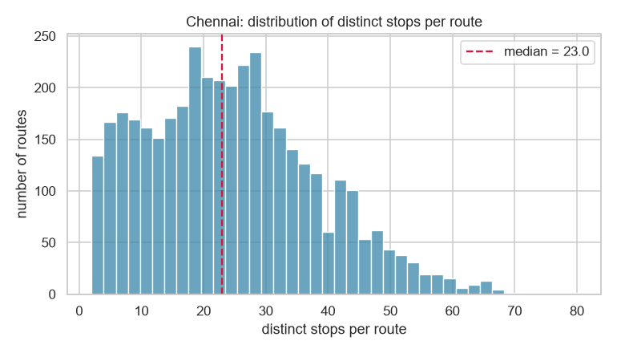

*Histogram of distinct stops per route. It shows whether most routes serve a similar number of stops or whether stop counts differ a lot.*

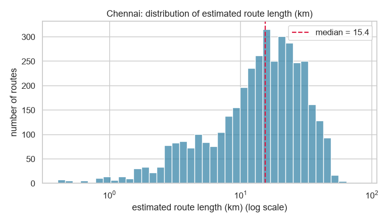

*Histogram of estimated route length (km, log scale). Lengths come from shapes.txt where available, otherwise from straight-line distances between stops.*

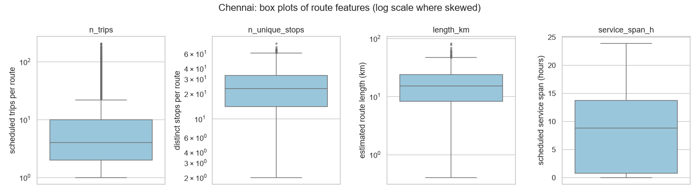

*Box plots of four route features (log scale where skewed): the box holds the middle 50% of routes, the line is the median and dots are statistical outliers (not necessarily errors).*

### 3. Scheduled service by time of day

* Hours with the most scheduled trip starts: 14:00 (3,021), 15:00 (2,972), 06:00 (2,941). Hours with the fewest: 02:00 (103), 00:00 (104), 01:00 (105).
* By period: morning 39.2% of scheduled trips (2,633 per hour); afternoon 30.6% of scheduled trips (2,877 per hour); evening 21.7% of scheduled trips (2,554 per hour); night 8.5% of scheduled trips (502 per hour). The busiest period per hour is afternoon and the quietest is night. These are planned services, not passenger numbers; strong concentration in a few hours can also reflect how the publisher compiled the timetable, so it should be checked with the operator before it is read as a real service pattern.
* Weekday vs weekend: scheduled trips on a typical weekday (Wednesday services) 47,047; on Sunday 46,973 (100% of the weekday level).

| period | hours | scheduled_trips | share_% | trips_per_hour |
|---|---|---|---|---|
| morning | 7 | 18430 | 39.20 | 2,633.00 |
| afternoon | 5 | 14385 | 30.60 | 2,877.00 |
| evening | 4 | 10216 | 21.70 | 2,554.00 |
| night | 8 | 4016 | 8.50 | 502.00 |

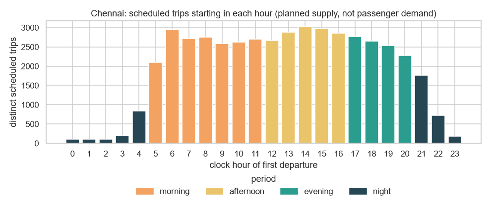

*Distinct scheduled trips whose first departure falls in each clock hour, coloured by time period. This is planned service supply; it is not passenger demand.*

*Scheduled trips by time period with each period's share of all scheduled trips. Periods have different lengths in hours, so compare trips per hour (in the table) as well.*

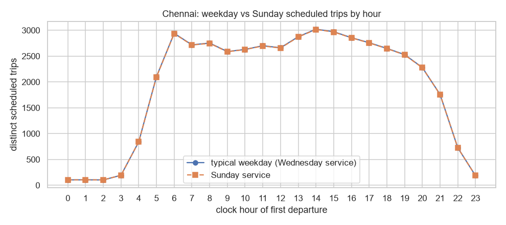

*Scheduled trips per hour on a typical weekday (services running on Wednesday) vs Sunday, from calendar.txt.*

### 4. Route-wise comparison

* Routes in the lowest quarter of scheduled trips (<= 1) have a median of 20 stops and 13.5 km; routes in the highest quarter (>= 22 trips) have 27 stops and 16.1 km.
* Median service span: 0.0 h (low-trip group) vs 15.2 h (high-trip group). A route with a single trip has a span of 0 by definition, so this difference is partly built in. It describes what the schedule looks like - not whether a route is efficient.
* Most stops on one route: 512 (80), 109T (72), 120KEt R (69). Most scheduled trips: 25 R (210), 25 R1 (208), 91 (202).

| group (by scheduled trips) | routes | n_trips | n_unique_stops | length_km | service_span_h | median_headway_min | avg_speed_kmh | max_stop_overlap |
|---|---|---|---|---|---|---|---|---|
| low (<= Q1) | 1558 | 1.00 | 20.00 | 13.48 | 0.00 | 450.00 | 21.51 | 0.76 |
| middle | 1343 | 5.00 | 24.00 | 16.43 | 10.17 | 110.00 | 21.95 | 0.76 |
| high (>= Q3) | 1033 | 22.00 | 27.00 | 16.12 | 15.23 | 25.00 | 20.78 | 0.76 |

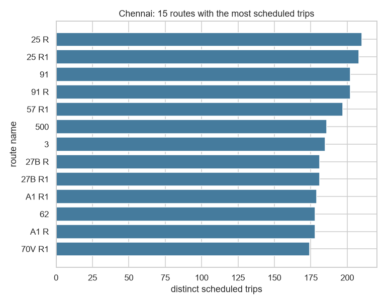

*The 15 routes with the most scheduled trips. High scheduled trip counts show where the timetable offers most departures; they do not show crowding.*

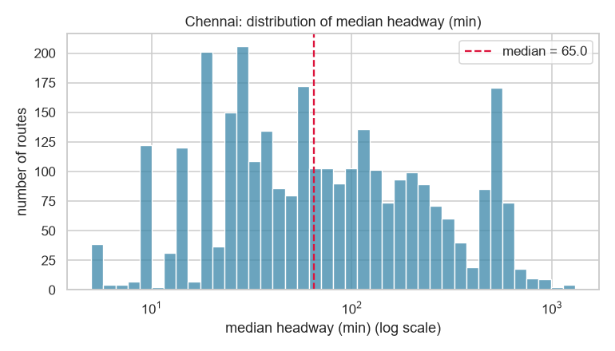

*Histogram of the median scheduled gap between consecutive departures of a route (headway, minutes, log scale). Routes with a single departure time have no headway and are not shown.*

### 5. Geographical analysis and overlap

* Stop map: `maps/chennai_stops_heatmap.html` (heat map of the 5,477 stops weighted by the number of routes calling there; the 15 stops with most routes are marked).
* **No usable route-shape data for buses in this feed**, so route paths are not drawn and path-based overlap is not computed (stop-based overlap only).
* Stop-based overlap (Jaccard similarity of the stop sets of two routes): 1760 routes have a partner with >= 80% similar stops, 3254 with >= 50% (1118 distinct pairs at >= 80%). Same-name routes and opposite-direction twins are excluded. Sharing stops does not prove that two routes are redundant.

Most similar route pairs by shared stops (candidates for further investigation, not conclusions):

| route_name | overlap_partner_name | max_stop_overlap | n_trips | partner_trips | length_km |
|---|---|---|---|---|---|
| 114D | 114 | 1.00 | 1 | 65 | 16.59 |
| 77E | 70ACt | 1.00 | 6 | 3 | 16.38 |
| 12X | 37ECt | 1.00 | 12 | 1 | 2.61 |
| 147A | 40N | 1.00 | 4 | 1 | 3.19 |
| 147A | 40N | 1.00 | 4 | 1 | 20.22 |
| 147B | 40L CT1 | 1.00 | 3 | 5 | 4.84 |
| 147B | 7M CT6 | 1.00 | 1 | 18 | 21.59 |
| 147C | 104F | 1.00 | 1 | 1 | 27.56 |

### 6. Association between features

* length_km vs n_trips: Spearman rho = 0.12 -> almost no association (the two vary almost independently).
* n_unique_stops vs n_trips: Spearman rho = 0.20 -> almost no association (the two vary almost independently).
* length_km vs n_unique_stops: Spearman rho = 0.86 -> a strong association (longer/larger routes tend to have higher values of both).
* length_km vs median_headway_min: Spearman rho = 0.12 -> almost no association (the two vary almost independently).

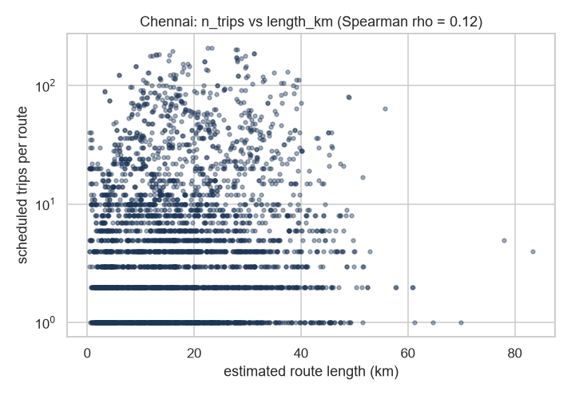

*Each dot is a route: estimated length against scheduled trips (log scale). The Spearman rho in the title measures how consistently they rise or fall together - an association, not a cause.*

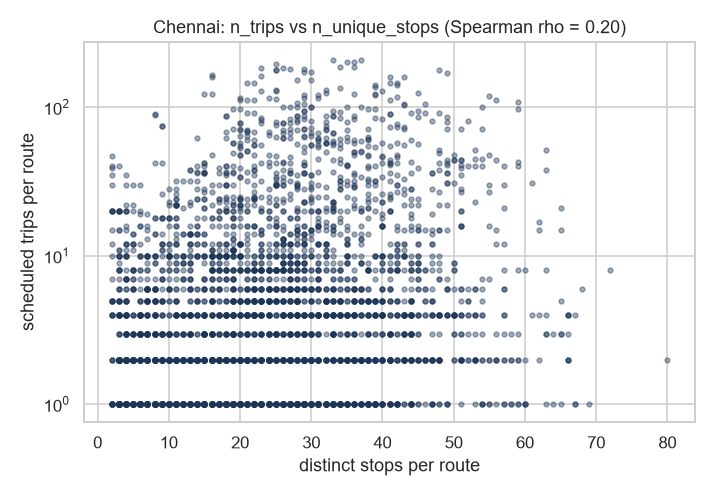

*Distinct stops against scheduled trips for each route; rho in the title as above.*

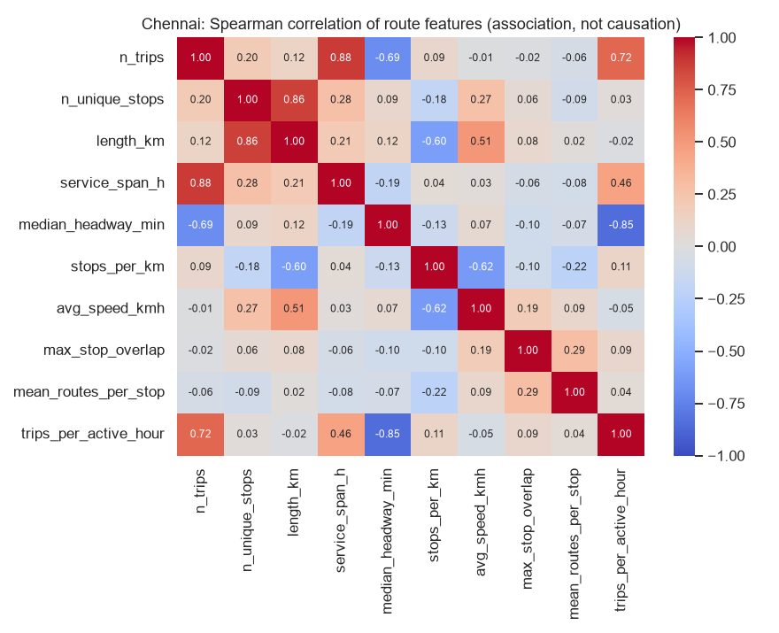

*Spearman correlation matrix of numeric route features. Colour shows the direction and strength of association between two features; identifiers are not included. Some pairs (scheduled trips, trips per active hour, headway, service span) are linked by definition, so their high correlation is expected and is not a finding.*

Correlation shows association only; it does not show that longer routes cause more or fewer trips.

---
## Delhi

**Data caveats for this city:**

* Scheduled speed is almost identical on all routes (10th-90th percentile 15.0-15.0 km/h), suggesting generated rather than operational stop times; durations and headways should be read as a model schedule.

### 1. Dataset inspection

* 2,964 rows x 47 columns (one row per route); duplicate rows: 0; duplicate route_id: 0.
* Columns with missing values: `median_headway_min` (96), `length_km_shape` (2964) (missing = undefined/unknown, never replaced by zero).

Summary statistics of the main numeric features:

| feature | count | min | median | mean | std | max | p90 |
|---|---|---|---|---|---|---|---|
| n_trips | 2,964.00 | 1.00 | 18.00 | 26.49 | 28.06 | 170.00 | 62.00 |
| n_unique_stops | 2,964.00 | 2.00 | 40.00 | 39.80 | 16.28 | 169.00 | 59.70 |
| length_km | 2,964.00 | 0.52 | 21.82 | 22.67 | 10.82 | 121.35 | 34.87 |
| service_span_h | 2,964.00 | 0.00 | 13.33 | 11.43 | 5.36 | 23.98 | 16.08 |
| median_headway_min | 2,868.00 | 2.00 | 27.00 | 50.94 | 84.77 | 1,320.00 | 98.00 |
| avg_trip_duration_min | 2,964.00 | 2.05 | 87.26 | 90.62 | 43.27 | 484.47 | 139.44 |
| trips_per_active_hour | 2,964.00 | 1.00 | 1.80 | 2.32 | 1.58 | 12.83 | 4.42 |
| stops_per_km | 2,964.00 | 0.42 | 1.85 | 1.84 | 0.38 | 4.26 | 2.26 |
| avg_speed_kmh | 2,964.00 | 10.32 | 15.01 | 15.01 | 0.12 | 15.08 | 15.03 |
| max_stop_overlap | 2,964.00 | 0.06 | 0.57 | 0.57 | 0.19 | 1.00 | 0.83 |
| mean_routes_per_stop | 2,964.00 | 3.67 | 48.81 | 49.32 | 17.01 | 116.09 | 72.14 |

### 2. Univariate analysis

* 2,964 routes in the dataset. Scheduled trips per route: median 18, mean 26.5, maximum 170 (9 times the median). 17% of routes have 5 or fewer scheduled trips and 15% have 50 or more, so service levels differ widely between routes.
* Distinct stops per route: median 40 (range 2-169).
* Estimated route length: median 21.8 km (middle half of routes 15.8-28.2 km). 0% of lengths come from shapes.txt; the rest are straight-line stop-to-stop distances, which understate road length.
* Scheduled service span (first to last departure): median 13.3 h; 61% of routes span 12 hours or more.
* Operating days: 100% of routes have the same number of scheduled trips on weekend days as on weekdays according to calendar.txt.

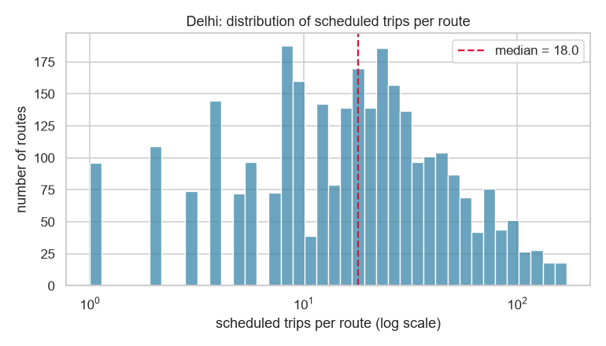

*Histogram of scheduled trips per route on a log scale. Each bar counts routes with that many trips; the dashed line is the median. A long right tail means a few routes have far more scheduled trips than most.*

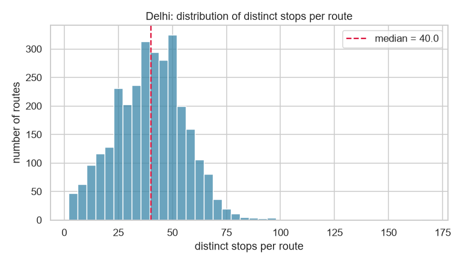

*Histogram of distinct stops per route. It shows whether most routes serve a similar number of stops or whether stop counts differ a lot.*

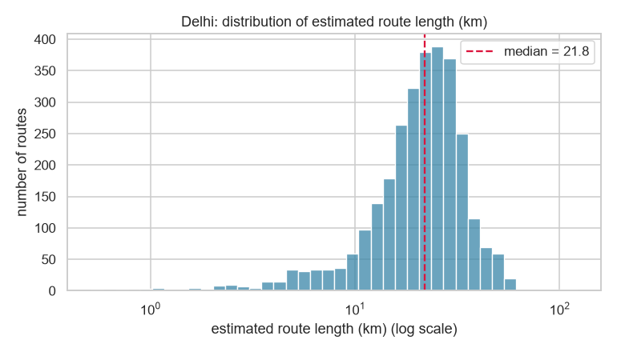

*Histogram of estimated route length (km, log scale). Lengths come from shapes.txt where available, otherwise from straight-line distances between stops.*

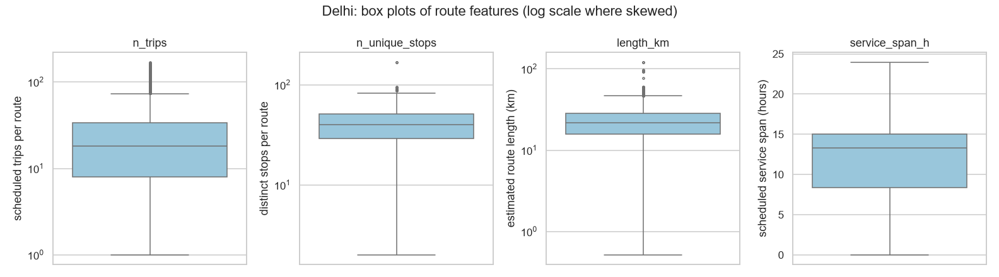

*Box plots of four route features (log scale where skewed): the box holds the middle 50% of routes, the line is the median and dots are statistical outliers (not necessarily errors).*

### 3. Scheduled service by time of day

* Hours with the most scheduled trip starts: 07:00 (5,209), 08:00 (5,182), 15:00 (5,060). Hours with the fewest: 02:00 (114), 03:00 (124), 01:00 (154).
* By period: morning 39.4% of scheduled trips (4,414 per hour); afternoon 29.4% of scheduled trips (4,623 per hour); evening 22.7% of scheduled trips (4,458 per hour); night 8.5% of scheduled trips (834 per hour). The busiest period per hour is afternoon and the quietest is night. These are planned services, not passenger numbers; strong concentration in a few hours can also reflect how the publisher compiled the timetable, so it should be checked with the operator before it is read as a real service pattern.
* Weekday vs weekend: scheduled trips on a typical weekday (Wednesday services) 78,507; on Sunday 78,507 (100% of the weekday level). The calendar describes identical service on both days.

| period | hours | scheduled_trips | share_% | trips_per_hour |
|---|---|---|---|---|
| morning | 7 | 30895 | 39.40 | 4,414.00 |
| afternoon | 5 | 23114 | 29.40 | 4,623.00 |
| evening | 4 | 17830 | 22.70 | 4,458.00 |
| night | 8 | 6668 | 8.50 | 834.00 |

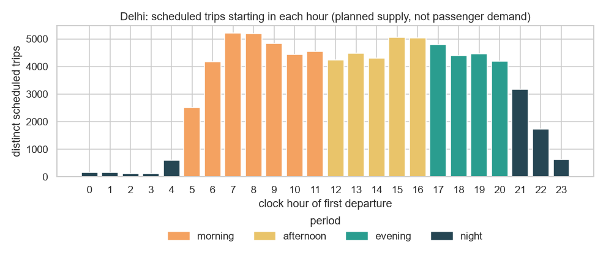

*Distinct scheduled trips whose first departure falls in each clock hour, coloured by time period. This is planned service supply; it is not passenger demand.*

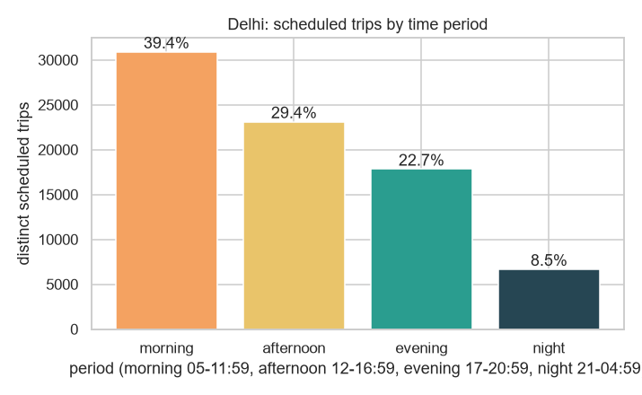

*Scheduled trips by time period with each period's share of all scheduled trips. Periods have different lengths in hours, so compare trips per hour (in the table) as well.*

### 4. Route-wise comparison

* Routes in the lowest quarter of scheduled trips (<= 5) have a median of 39 stops and 21.8 km; routes in the highest quarter (>= 54 trips) have 43 stops and 22.6 km.
* Median service span: 4.3 h (low-trip group) vs 15.4 h (high-trip group). It describes what the schedule looks like - not whether a route is efficient.
* Most stops on one route: OMS(+)UP (169), OMS(-)DOWN (169), GRAMINMUDRIKA(-)DOWN (95). Most scheduled trips: 901CLUP (170), 33UP (166), 469UP (166).

| group (by scheduled trips) | routes | n_trips | n_unique_stops | length_km | service_span_h | median_headway_min | avg_speed_kmh | max_stop_overlap |
|---|---|---|---|---|---|---|---|---|
| low (<= Q1) | 854 | 5.00 | 39.00 | 21.78 | 4.27 | 60.00 | 15.01 | 0.58 |
| middle | 1366 | 18.00 | 40.00 | 21.44 | 13.53 | 30.00 | 15.01 | 0.57 |
| high (>= Q3) | 744 | 54.00 | 43.00 | 22.65 | 15.42 | 12.00 | 15.01 | 0.56 |

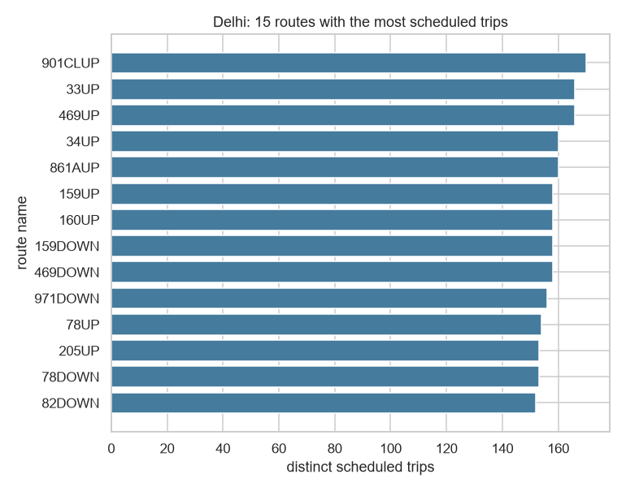

*The 15 routes with the most scheduled trips. High scheduled trip counts show where the timetable offers most departures; they do not show crowding.*

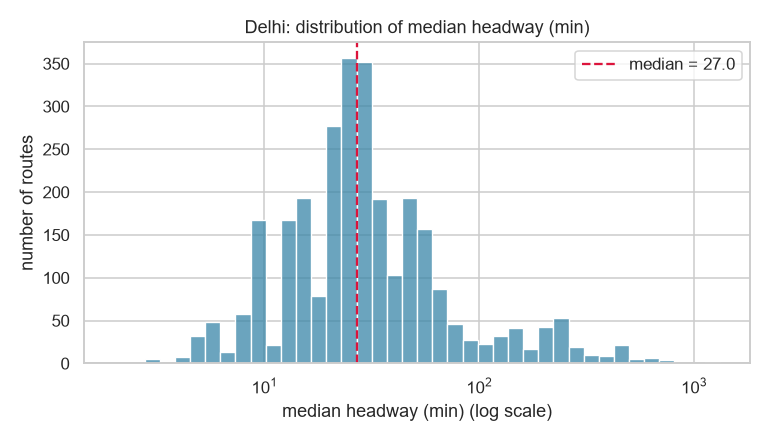

*Histogram of the median scheduled gap between consecutive departures of a route (headway, minutes, log scale). Routes with a single departure time have no headway and are not shown.*

### 5. Geographical analysis and overlap

* Stop map: `maps/delhi_stops_heatmap.html` (heat map of the 6,267 stops weighted by the number of routes calling there; the 15 stops with most routes are marked).
* **No usable route-shape data for buses in this feed**, so route paths are not drawn and path-based overlap is not computed (stop-based overlap only).
* Stop-based overlap (Jaccard similarity of the stop sets of two routes): 383 routes have a partner with >= 80% similar stops, 1849 with >= 50% (222 distinct pairs at >= 80%). Same-name routes and opposite-direction twins are excluded. Sharing stops does not prove that two routes are redundant.

Most similar route pairs by shared stops (candidates for further investigation, not conclusions):

| route_name | overlap_partner_name | max_stop_overlap | n_trips | partner_trips | length_km |
|---|---|---|---|---|---|
| 764MSTLDOWN | 743STLDOWN | 1.00 | 103 | 39 | 17.11 |
| 185LSTLUP | 185LSTL2UP | 1.00 | 2 | 12 | 5.12 |
| CGOCOMPLEX-1DOWN | 624ASTLDOWN | 1.00 | 4 | 7 | 9.71 |
| 892STLDOWN | 892LSTLUP | 1.00 | 8 | 2 | 11.68 |
| 08STLUP | AIRPORTEXP08STLUP | 1.00 | 4 | 27 | 13.36 |
| 790STLDOWN | 708STLUP | 1.00 | 4 | 42 | 2.65 |
| S1STLDOWN | 819STLDOWN | 1.00 | 6 | 4 | 2.55 |
| 578LSTLUP | 790STLUP | 1.00 | 12 | 2 | 3.75 |

### 6. Association between features

* length_km vs n_trips: Spearman rho = 0.03 -> almost no association (the two vary almost independently).
* n_unique_stops vs n_trips: Spearman rho = 0.10 -> almost no association (the two vary almost independently).
* length_km vs n_unique_stops: Spearman rho = 0.88 -> a strong association (longer/larger routes tend to have higher values of both).
* length_km vs median_headway_min: Spearman rho = 0.07 -> almost no association (the two vary almost independently).

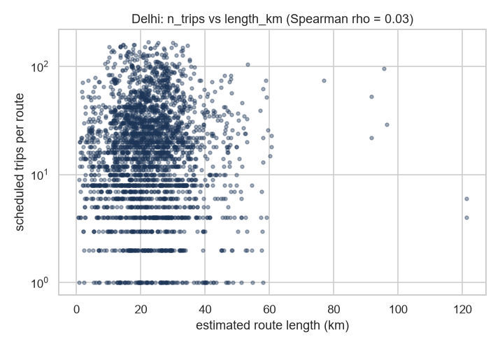

*Each dot is a route: estimated length against scheduled trips (log scale). The Spearman rho in the title measures how consistently they rise or fall together - an association, not a cause.*

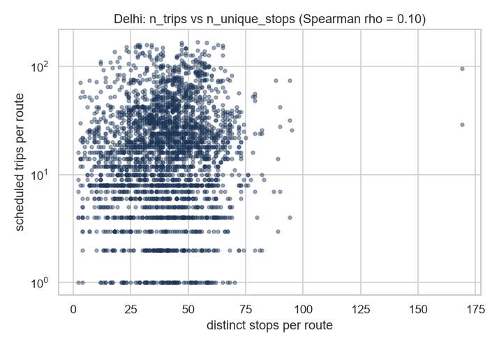

*Distinct stops against scheduled trips for each route; rho in the title as above.*

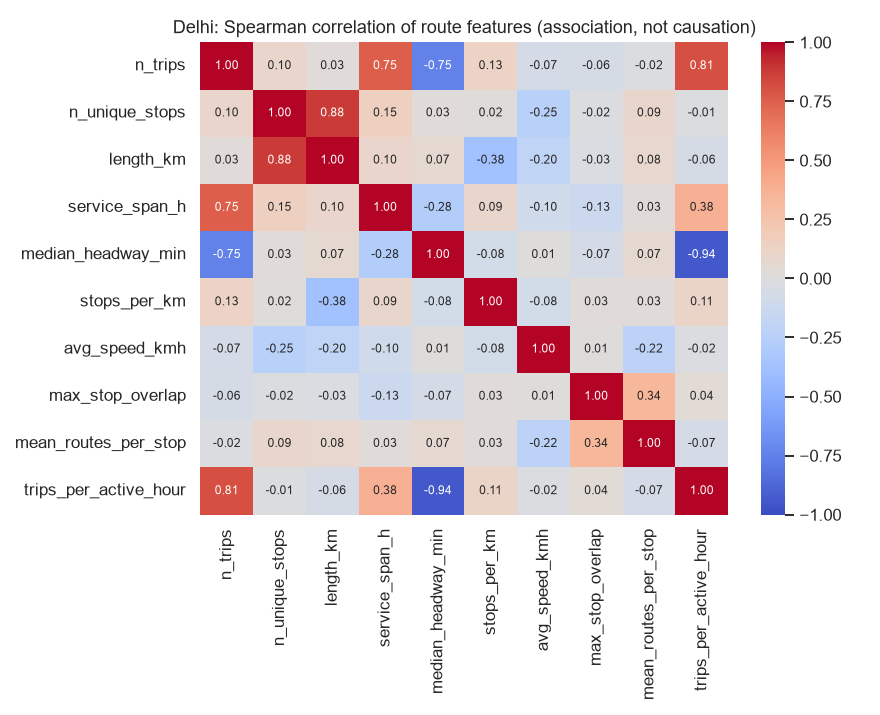

*Spearman correlation matrix of numeric route features. Colour shows the direction and strength of association between two features; identifiers are not included. Some pairs (scheduled trips, trips per active hour, headway, service span) are linked by definition, so their high correlation is expected and is not a finding.*

Correlation shows association only; it does not show that longer routes cause more or fewer trips.

---
## Hyderabad

**Data caveats for this city:**

* 71% of routes have a median scheduled trip longer than 8 hours: the feed's 'trips' appear to be whole vehicle duties, so trip counts and headways are NOT comparable with cities whose trips are single runs.

### 1. Dataset inspection

* 1,031 rows x 48 columns (one row per route); duplicate rows: 0; duplicate route_id: 0.
* Columns with missing values: `median_headway_min` (145), `length_km_shape` (1031) (missing = undefined/unknown, never replaced by zero).

Summary statistics of the main numeric features:

| feature | count | min | median | mean | std | max | p90 |
|---|---|---|---|---|---|---|---|
| n_trips | 1,031.00 | 1.00 | 8.00 | 43.54 | 119.07 | 2,087.00 | 117.00 |
| n_unique_stops | 1,031.00 | 2.00 | 55.00 | 63.86 | 54.33 | 795.00 | 111.00 |
| length_km | 1,031.00 | 0.59 | 26.45 | 31.10 | 50.35 | 1,390.70 | 49.90 |
| service_span_h | 1,031.00 | 0.00 | 12.70 | 12.83 | 9.58 | 80.25 | 28.25 |
| median_headway_min | 886.00 | 2.00 | 50.00 | 123.41 | 206.07 | 1,500.00 | 386.25 |
| avg_trip_duration_min | 1,031.00 | 5.00 | 835.70 | 1,043.05 | 827.14 | 5,699.17 | 2,133.46 |
| trips_per_active_hour | 1,031.00 | 1.00 | 1.36 | 3.12 | 5.77 | 99.38 | 6.89 |
| stops_per_km | 1,031.00 | 0.03 | 2.14 | 2.34 | 1.43 | 13.95 | 3.86 |
| avg_speed_kmh | 1,031.00 | 0.56 | 1.83 | 3.40 | 9.05 | 245.14 | 5.80 |
| max_stop_overlap | 1,031.00 | 0.06 | 0.56 | 0.57 | 0.20 | 1.00 | 0.84 |
| mean_routes_per_stop | 1,031.00 | 4.76 | 49.72 | 51.11 | 18.98 | 117.17 | 77.39 |

### 2. Univariate analysis

* 1,031 routes in the dataset. Scheduled trips per route: median 8, mean 43.5, maximum 2,087 (261 times the median). 44% of routes have 5 or fewer scheduled trips and 19% have 50 or more, so service levels differ widely between routes.
* Distinct stops per route: median 55 (range 2-795).
* Estimated route length: median 26.4 km (middle half of routes 17.5-36.4 km). 0% of lengths come from shapes.txt; the rest are straight-line stop-to-stop distances, which understate road length.
* Scheduled service span (first to last departure): median 12.7 h; 53% of routes span 12 hours or more.
* Operating days: 100% of routes have the same number of scheduled trips on weekend days as on weekdays according to calendar.txt.

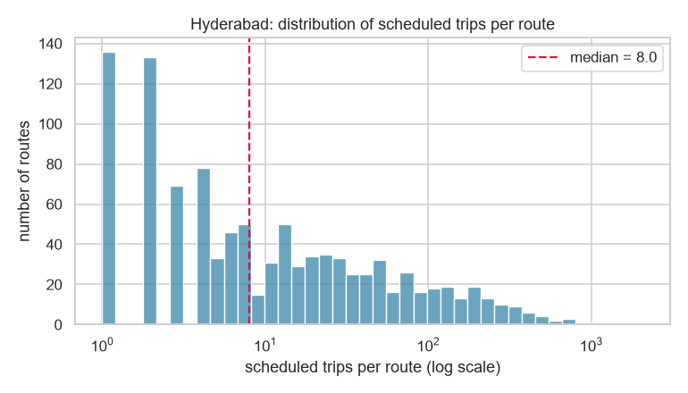

*Histogram of scheduled trips per route on a log scale. Each bar counts routes with that many trips; the dashed line is the median. A long right tail means a few routes have far more scheduled trips than most.*

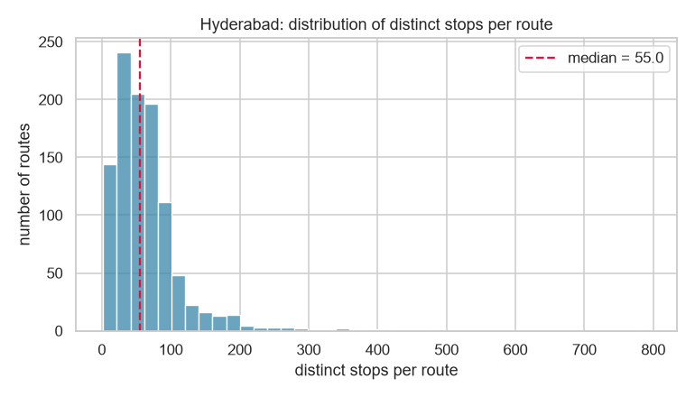

*Histogram of distinct stops per route. It shows whether most routes serve a similar number of stops or whether stop counts differ a lot.*

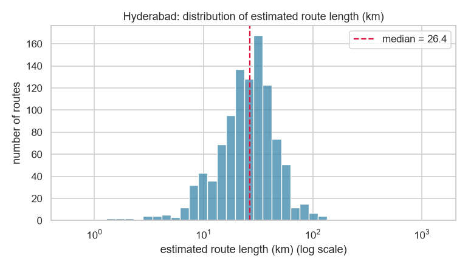

*Histogram of estimated route length (km, log scale). Lengths come from shapes.txt where available, otherwise from straight-line distances between stops.*

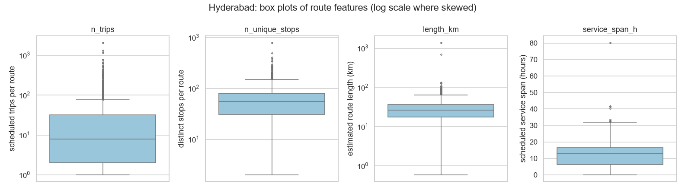

*Box plots of four route features (log scale where skewed): the box holds the middle 50% of routes, the line is the median and dots are statistical outliers (not necessarily errors).*

### 3. Scheduled service by time of day

* Hours with the most scheduled trip starts: 07:00 (3,183), 15:00 (2,969), 14:00 (2,963). Hours with the fewest: 01:00 (14), 02:00 (15), 00:00 (22).
* By period: morning 41.1% of scheduled trips (2,634 per hour); afternoon 30.7% of scheduled trips (2,754 per hour); evening 23.2% of scheduled trips (2,600 per hour); night 5.1% of scheduled trips (286 per hour). The busiest period per hour is afternoon and the quietest is night. These are planned services, not passenger numbers; strong concentration in a few hours can also reflect how the publisher compiled the timetable, so it should be checked with the operator before it is read as a real service pattern.
* Weekday vs weekend: scheduled trips on a typical weekday (Wednesday services) 44,892; on Sunday 44,892 (100% of the weekday level). The calendar describes identical service on both days.

| period | hours | scheduled_trips | share_% | trips_per_hour |
|---|---|---|---|---|
| morning | 7 | 18435 | 41.10 | 2,634.00 |
| afternoon | 5 | 13769 | 30.70 | 2,754.00 |
| evening | 4 | 10401 | 23.20 | 2,600.00 |
| night | 8 | 2287 | 5.10 | 286.00 |

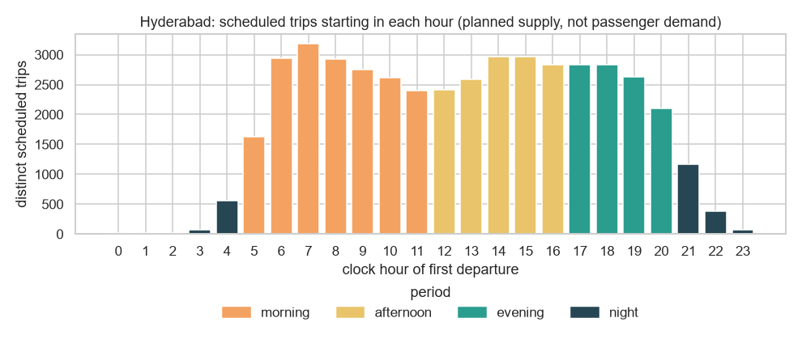

*Distinct scheduled trips whose first departure falls in each clock hour, coloured by time period. This is planned service supply; it is not passenger demand.*

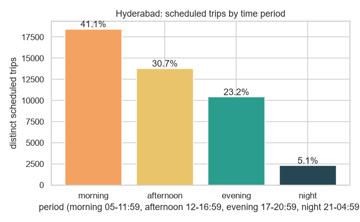

*Scheduled trips by time period with each period's share of all scheduled trips. Periods have different lengths in hours, so compare trips per hour (in the table) as well.*

### 4. Route-wise comparison

* Routes in the lowest quarter of scheduled trips (<= 1) have a median of 30 stops and 23.1 km; routes in the highest quarter (>= 86 trips) have 86 stops and 27.8 km.
* Median service span: 0.0 h (low-trip group) vs 18.6 h (high-trip group). A route with a single trip has a span of 0 by definition, so this difference is partly built in. It describes what the schedule looks like - not whether a route is efficient.
* Most stops on one route: 219 (795), 300 (496), 216 (405). Most scheduled trips: 219 (2,087), 300 (1,314), 10H (1,161).

| group (by scheduled trips) | routes | n_trips | n_unique_stops | length_km | service_span_h | median_headway_min | avg_speed_kmh | max_stop_overlap |
|---|---|---|---|---|---|---|---|---|
| low (<= Q1) | 269 | 1.00 | 30.00 | 23.09 | 0.00 | 426.00 | 1.59 | 0.50 |
| middle | 503 | 8.00 | 58.00 | 28.37 | 12.67 | 65.00 | 1.82 | 0.62 |
| high (>= Q3) | 259 | 86.00 | 86.00 | 27.76 | 18.58 | 10.00 | 2.14 | 0.56 |

*The 15 routes with the most scheduled trips. High scheduled trip counts show where the timetable offers most departures; they do not show crowding.*

*Histogram of the median scheduled gap between consecutive departures of a route (headway, minutes, log scale). Routes with a single departure time have no headway and are not shown.*

### 5. Geographical analysis and overlap

* Stop map: `maps/hyderabad_stops_heatmap.html` (heat map of the 5,028 stops weighted by the number of routes calling there; the 15 stops with most routes are marked).
* **No usable route-shape data for buses in this feed**, so route paths are not drawn and path-based overlap is not computed (stop-based overlap only).
* Stop-based overlap (Jaccard similarity of the stop sets of two routes): 171 routes have a partner with >= 80% similar stops, 649 with >= 50% (99 distinct pairs at >= 80%). Same-name routes and opposite-direction twins are excluded. Sharing stops does not prove that two routes are redundant.

Most similar route pairs by shared stops (candidates for further investigation, not conclusions):

| route_name | overlap_partner_name | max_stop_overlap | n_trips | partner_trips | length_km |
|---|---|---|---|---|---|
| 70 | 85 | 1.00 | 1 | 1 | 13.93 |
| AA | AM | 1.00 | 55 | 9 | 32.07 |
| 25M/22 | 25M/22H | 1.00 | 4 | 3 | 10.04 |
| 2V | 83V | 1.00 | 40 | 10 | 2.29 |
| 205B | 205T | 0.99 | 2 | 2 | 28.50 |
| 116G | 116G/220K | 0.97 | 54 | 17 | 57.27 |
| 300D | 92A/251V | 0.97 | 19 | 1 | 30.78 |
| 203A/R | 203W | 0.96 | 8 | 6 | 33.22 |

### 6. Association between features

* length_km vs n_trips: Spearman rho = 0.10 -> almost no association (the two vary almost independently).
* n_unique_stops vs n_trips: Spearman rho = 0.58 -> a moderate association (longer/larger routes tend to have higher values of both).
* length_km vs n_unique_stops: Spearman rho = 0.61 -> a moderate association (longer/larger routes tend to have higher values of both).
* length_km vs median_headway_min: Spearman rho = 0.12 -> almost no association (the two vary almost independently).

*Each dot is a route: estimated length against scheduled trips (log scale). The Spearman rho in the title measures how consistently they rise or fall together - an association, not a cause.*

*Distinct stops against scheduled trips for each route; rho in the title as above.*

*Spearman correlation matrix of numeric route features. Colour shows the direction and strength of association between two features; identifiers are not included. Some pairs (scheduled trips, trips per active hour, headway, service span) are linked by definition, so their high correlation is expected and is not a finding.*

Correlation shows association only; it does not show that longer routes cause more or fewer trips.

---
## Kochi

**Data caveats for this city:**

* Scheduled speed is almost identical on all routes (10th-90th percentile 20.8-22.4 km/h), suggesting generated rather than operational stop times; durations and headways should be read as a model schedule.
* Trip counts come from expanding frequency templates (a bus every N minutes), so routes look uniform because the publisher used a uniform pattern; this is not measured service.

### 1. Dataset inspection

* 465 rows x 48 columns (one row per route); duplicate rows: 0; duplicate route_id: 0.
* Columns with missing values: none (missing = undefined/unknown, never replaced by zero).

Summary statistics of the main numeric features:

| feature | count | min | median | mean | std | max | p90 |
|---|---|---|---|---|---|---|---|
| n_trips | 465.00 | 17.00 | 34.00 | 33.51 | 3.04 | 51.00 | 34.00 |
| n_unique_stops | 465.00 | 14.00 | 100.00 | 98.31 | 40.49 | 210.00 | 146.00 |
| length_km | 465.00 | 2.75 | 23.18 | 23.27 | 9.86 | 50.57 | 36.26 |
| service_span_h | 465.00 | 13.50 | 16.00 | 15.99 | 0.12 | 16.00 | 16.00 |
| median_headway_min | 465.00 | 60.00 | 60.00 | 60.00 | 0.00 | 60.00 | 60.00 |
| avg_trip_duration_min | 465.00 | 7.54 | 64.84 | 65.11 | 27.79 | 144.60 | 101.70 |
| trips_per_active_hour | 465.00 | 1.00 | 2.00 | 1.97 | 0.18 | 3.00 | 2.00 |
| stops_per_km | 465.00 | 1.44 | 4.43 | 4.34 | 0.81 | 6.56 | 5.16 |
| avg_speed_kmh | 465.00 | 20.20 | 21.37 | 21.51 | 0.73 | 24.85 | 22.38 |
| max_stop_overlap | 465.00 | 0.02 | 0.77 | 0.73 | 0.19 | 1.00 | 0.95 |
| mean_routes_per_stop | 465.00 | 1.77 | 53.16 | 55.16 | 32.24 | 130.20 | 97.93 |

### 2. Univariate analysis

* 465 routes in the dataset. Scheduled trips per route: median 34, mean 33.5, maximum 51 (2 times the median). 0% of routes have 5 or fewer scheduled trips and 0% have 50 or more, so service levels differ widely between routes.
* Distinct stops per route: median 100 (range 14-210).
* Estimated route length: median 23.2 km (middle half of routes 16.1-29.3 km). 100% of lengths come from shapes.txt; the rest are straight-line stop-to-stop distances, which understate road length.
* Scheduled service span (first to last departure): median 16.0 h; 100% of routes span 12 hours or more.
* Operating days: 100% of routes have the same number of scheduled trips on weekend days as on weekdays according to calendar.txt.

*Histogram of scheduled trips per route on a log scale. Each bar counts routes with that many trips; the dashed line is the median. A long right tail means a few routes have far more scheduled trips than most.*

*Histogram of distinct stops per route. It shows whether most routes serve a similar number of stops or whether stop counts differ a lot.*

*Histogram of estimated route length (km, log scale). Lengths come from shapes.txt where available, otherwise from straight-line distances between stops.*

*Box plots of four route features (log scale where skewed): the box holds the middle 50% of routes, the line is the median and dots are statistical outliers (not necessarily errors).*

### 3. Scheduled service by time of day

* Hours with the most scheduled trip starts: 06:00 (917), 07:00 (917), 08:00 (917). Hours with the fewest: 00:00 (0), 01:00 (0), 02:00 (0). No trip starts at all in hours 00, 01, 02, 03, 04, 22, 23.
* By period: morning 41.2% of scheduled trips (917 per hour); afternoon 29.4% of scheduled trips (916 per hour); evening 23.5% of scheduled trips (917 per hour); night 5.9% of scheduled trips (114 per hour). The busiest period per hour is morning and the quietest is night. These are planned services, not passenger numbers; strong concentration in a few hours can also reflect how the publisher compiled the timetable, so it should be checked with the operator before it is read as a real service pattern.
* Weekday vs weekend: scheduled trips on a typical weekday (Wednesday services) 15,581; on Sunday 15,581 (100% of the weekday level). The calendar describes identical service on both days.

| period | hours | scheduled_trips | share_% | trips_per_hour |
|---|---|---|---|---|
| morning | 7 | 6417 | 41.20 | 917.00 |
| afternoon | 5 | 4581 | 29.40 | 916.00 |
| evening | 4 | 3668 | 23.50 | 917.00 |
| night | 8 | 915 | 5.90 | 114.00 |

*Distinct scheduled trips whose first departure falls in each clock hour, coloured by time period. This is planned service supply; it is not passenger demand.*

*Scheduled trips by time period with each period's share of all scheduled trips. Periods have different lengths in hours, so compare trips per hour (in the table) as well.*

### 4. Route-wise comparison

* Routes in the lowest quarter of scheduled trips (<= 34) have a median of 100 stops and 23.1 km; routes in the highest quarter (>= 51 trips) have 103 stops and 24.1 km.
* Median service span: 16.0 h (low-trip group) vs 16.0 h (high-trip group). It describes what the schedule looks like - not whether a route is efficient.
* Most stops on one route: Kakkanad ↔ Medical College (210), Chellanam ↔ Methanam (208), Perumbavoor ↔ Wellington Island (204). Most scheduled trips: Kaloor ↔ North Paravur (51), High Court ↔ Nedungad (via Vypin) (34), Manjanakad ↔ High Court (34).

| group (by scheduled trips) | routes | n_trips | n_unique_stops | length_km | service_span_h | median_headway_min | avg_speed_kmh | max_stop_overlap |
|---|---|---|---|---|---|---|---|---|
| low (<= Q1) | 464.00 | 34.00 | 100.00 | 23.14 | 16.00 | 60.00 | 21.37 | 0.77 |
| middle |  |  |  |  |  |  |  |  |
| high (>= Q3) | 1.00 | 51.00 | 103.00 | 24.05 | 16.00 | 60.00 | 20.97 | 0.76 |

*The 15 routes with the most scheduled trips. High scheduled trip counts show where the timetable offers most departures; they do not show crowding.*

*Histogram of the median scheduled gap between consecutive departures of a route (headway, minutes, log scale). Routes with a single departure time have no headway and are not shown.*

### 5. Geographical analysis and overlap

* Stop map: `maps/kochi_stops_heatmap.html` (heat map of the 3,228 stops weighted by the number of routes calling there; the 15 stops with most routes are marked).
* Route shapes available for 100% of routes: `maps/kochi_top_route_shapes.html`, `maps/kochi_shape_overlap_pair.html`.
* Stop-based overlap (Jaccard similarity of the stop sets of two routes): 195 routes have a partner with >= 80% similar stops, 404 with >= 50% (114 distinct pairs at >= 80%). Same-name routes and opposite-direction twins are excluded. Sharing stops does not prove that two routes are redundant.
* Path-based overlap from shapes.txt (~200 m grid cells): 219 routes share >= 80% of their corridor with another route, 410 share >= 50%.

Most similar route pairs by shared stops (candidates for further investigation, not conclusions):

| route_name | overlap_partner_name | max_stop_overlap | n_trips | partner_trips | length_km |
|---|---|---|---|---|---|
| Fort Kochi ↔ Kakkanad (via Menaka) | Fort Kochi ↔ Kakkanad | 1.00 | 34 | 34 | 25.96 |
| Chittoor Temple ↔ Chottanikara | Chittoor Temple ↔ Chottanikkara | 1.00 | 34 | 34 | 27.76 |
| Aluva ↔ Thrippoonithura (via Palikkara) | Aluva ↔ Thrippoonithura | 1.00 | 34 | 34 | 29.16 |
| Kakkanad ↔ Thrippoonithura | Thrippoonithura ↔ Kakkanad | 1.00 | 34 | 34 | 10.20 |
| Thrippoonithura ↔ Infopark | Kinfra ↔ Thrippoonithura | 1.00 | 34 | 34 | 13.56 |
| Eloor ↔ Poothotta (via Bypass) | Poothotta ↔ Eloor | 1.00 | 34 | 34 | 37.39 |
| Eroor ↔ Eroor | Kozhivettumveli ↔ Kozhivettumveli | 1.00 | 17 | 17 | 29.34 |
| Ernakulam South ↔ Pukkattupady | Pukkattupady ↔ Ernakulam South | 1.00 | 34 | 34 | 21.33 |

### 6. Association between features

* length_km vs n_trips: Spearman rho = -0.01 -> almost no association (the two vary almost independently).
* n_unique_stops vs n_trips: Spearman rho = 0.18 -> almost no association (the two vary almost independently).
* length_km vs n_unique_stops: Spearman rho = 0.89 -> a strong association (longer/larger routes tend to have higher values of both).
* length_km vs median_headway_min: Spearman rho = nan -> a strong association (the two vary almost independently).

*Each dot is a route: estimated length against scheduled trips (log scale). The Spearman rho in the title measures how consistently they rise or fall together - an association, not a cause.*

*Distinct stops against scheduled trips for each route; rho in the title as above.*

*Spearman correlation matrix of numeric route features. Colour shows the direction and strength of association between two features; identifiers are not included. Some pairs (scheduled trips, trips per active hour, headway, service span) are linked by definition, so their high correlation is expected and is not a finding.*

Correlation shows association only; it does not show that longer routes cause more or fewer trips.

---
## Pune

**Data caveats for this city:**

* Scheduled speed is almost identical on all routes (10th-90th percentile 18.2-20.6 km/h), suggesting generated rather than operational stop times; durations and headways should be read as a model schedule.

### 1. Dataset inspection

* 315 rows x 48 columns (one row per route); duplicate rows: 0; duplicate route_id: 0.
* Columns with missing values: none (missing = undefined/unknown, never replaced by zero).

Summary statistics of the main numeric features:

| feature | count | min | median | mean | std | max | p90 |
|---|---|---|---|---|---|---|---|
| n_trips | 315.00 | 3.00 | 22.00 | 32.15 | 29.74 | 175.00 | 77.00 |
| n_unique_stops | 315.00 | 10.00 | 79.00 | 82.09 | 40.34 | 212.00 | 136.00 |
| length_km | 315.00 | 3.11 | 19.99 | 22.49 | 13.46 | 70.70 | 40.75 |
| service_span_h | 315.00 | 3.08 | 9.42 | 10.02 | 3.95 | 23.50 | 16.18 |
| median_headway_min | 315.00 | 3.00 | 30.00 | 42.05 | 35.21 | 200.00 | 95.00 |
| avg_trip_duration_min | 315.00 | 10.38 | 61.91 | 70.38 | 42.58 | 237.23 | 126.45 |
| trips_per_active_hour | 315.00 | 1.00 | 2.00 | 3.00 | 2.26 | 15.91 | 6.23 |
| stops_per_km | 315.00 | 1.82 | 3.87 | 3.93 | 0.83 | 7.07 | 4.95 |
| avg_speed_kmh | 315.00 | 2.52 | 19.36 | 19.35 | 2.08 | 37.82 | 20.63 |
| max_stop_overlap | 315.00 | 0.02 | 0.49 | 0.48 | 0.18 | 0.92 | 0.73 |
| mean_routes_per_stop | 315.00 | 1.67 | 11.57 | 12.13 | 6.11 | 27.32 | 21.10 |

### 2. Univariate analysis

* 315 routes in the dataset. Scheduled trips per route: median 22, mean 32.2, maximum 175 (8 times the median). 14% of routes have 5 or fewer scheduled trips and 25% have 50 or more, so service levels differ widely between routes.
* Distinct stops per route: median 79 (range 10-212).
* Estimated route length: median 20.0 km (middle half of routes 12.3-29.0 km). 99% of lengths come from shapes.txt; the rest are straight-line stop-to-stop distances, which understate road length.
* Scheduled service span (first to last departure): median 9.4 h; 24% of routes span 12 hours or more.
* Operating days: 100% of routes have the same number of scheduled trips on weekend days as on weekdays according to calendar.txt.

*Histogram of scheduled trips per route on a log scale. Each bar counts routes with that many trips; the dashed line is the median. A long right tail means a few routes have far more scheduled trips than most.*

*Histogram of distinct stops per route. It shows whether most routes serve a similar number of stops or whether stop counts differ a lot.*

*Histogram of estimated route length (km, log scale). Lengths come from shapes.txt where available, otherwise from straight-line distances between stops.*

*Box plots of four route features (log scale where skewed): the box holds the middle 50% of routes, the line is the median and dots are statistical outliers (not necessarily errors).*

### 3. Scheduled service by time of day

* Hours with the most scheduled trip starts: 08:00 (1,186), 09:00 (1,160), 07:00 (1,118). Hours with the fewest: 23:00 (6), 00:00 (7), 02:00 (7).
* By period: morning 68.3% of scheduled trips (988 per hour); afternoon 28.3% of scheduled trips (574 per hour); evening 2.1% of scheduled trips (54 per hour); night 1.2% of scheduled trips (16 per hour). The busiest period per hour is morning and the quietest is night. These are planned services, not passenger numbers; strong concentration in a few hours can also reflect how the publisher compiled the timetable, so it should be checked with the operator before it is read as a real service pattern.
* Weekday vs weekend: scheduled trips on a typical weekday (Wednesday services) 10,128; on Sunday 10,128 (100% of the weekday level). The calendar describes identical service on both days.

| period | hours | scheduled_trips | share_% | trips_per_hour |
|---|---|---|---|---|
| morning | 7 | 6917 | 68.30 | 988.00 |
| afternoon | 5 | 2870 | 28.30 | 574.00 |
| evening | 4 | 215 | 2.10 | 54.00 |
| night | 8 | 126 | 1.20 | 16.00 |

*Distinct scheduled trips whose first departure falls in each clock hour, coloured by time period. This is planned service supply; it is not passenger demand.*

*Scheduled trips by time period with each period's share of all scheduled trips. Periods have different lengths in hours, so compare trips per hour (in the table) as well.*

### 4. Route-wise comparison

* Routes in the lowest quarter of scheduled trips (<= 5) have a median of 92 stops and 22.2 km; routes in the highest quarter (>= 73 trips) have 84 stops and 22.1 km.
* Median service span: 6.1 h (low-trip group) vs 11.6 h (high-trip group). It describes what the schedule looks like - not whether a route is efficient.
* Most stops on one route: 231 (212), 65A (193), 159B (190). Most scheduled trips: 5 (175), 114 (116), H8 (110).

| group (by scheduled trips) | routes | n_trips | n_unique_stops | length_km | service_span_h | median_headway_min | avg_speed_kmh | max_stop_overlap |
|---|---|---|---|---|---|---|---|---|
| low (<= Q1) | 81 | 5.00 | 92.00 | 22.21 | 6.08 | 87.50 | 19.24 | 0.53 |
| middle | 155 | 22.00 | 68.00 | 17.55 | 9.42 | 30.00 | 19.34 | 0.48 |
| high (>= Q3) | 79 | 73.00 | 84.00 | 22.14 | 11.58 | 10.00 | 19.54 | 0.46 |

*The 15 routes with the most scheduled trips. High scheduled trip counts show where the timetable offers most departures; they do not show crowding.*

*Histogram of the median scheduled gap between consecutive departures of a route (headway, minutes, log scale). Routes with a single departure time have no headway and are not shown.*

### 5. Geographical analysis and overlap

* Stop map: `maps/pune_stops_heatmap.html` (heat map of the 6,745 stops weighted by the number of routes calling there; the 15 stops with most routes are marked).
* Route shapes available for 99% of routes: `maps/pune_top_route_shapes.html`, `maps/pune_shape_overlap_pair.html`.
* Stop-based overlap (Jaccard similarity of the stop sets of two routes): 16 routes have a partner with >= 80% similar stops, 154 with >= 50% (8 distinct pairs at >= 80%). Same-name routes and opposite-direction twins are excluded. Sharing stops does not prove that two routes are redundant.
* Path-based overlap from shapes.txt (~200 m grid cells): 18 routes share >= 80% of their corridor with another route, 169 share >= 50%.

Most similar route pairs by shared stops (candidates for further investigation, not conclusions):

| route_name | overlap_partner_name | max_stop_overlap | n_trips | partner_trips | length_km |
|---|---|---|---|---|---|
| 367 | 367M | 0.92 | 25 | 7 | 18.99 |
| 324 | 345 | 0.87 | 102 | 16 | 26.25 |
| 305A | 305B | 0.86 | 13 | 4 | 32.54 |
| 355 | 355A | 0.84 | 48 | 53 | 21.49 |
| 11 | 11A | 0.83 | 40 | 4 | 17.82 |
| 231 | 233A | 0.83 | 4 | 12 | 56.45 |
| 174 | RATRANI 7 | 0.82 | 49 | 6 | 19.75 |
| 358 | 359A | 0.81 | 82 | 6 | 29.18 |

### 6. Association between features

* length_km vs n_trips: Spearman rho = -0.13 -> almost no association (the two vary almost independently).
* n_unique_stops vs n_trips: Spearman rho = -0.17 -> almost no association (the two vary almost independently).
* length_km vs n_unique_stops: Spearman rho = 0.95 -> a strong association (longer/larger routes tend to have higher values of both).
* length_km vs median_headway_min: Spearman rho = 0.21 -> a weak association (longer/larger routes tend to have higher values of both).

*Each dot is a route: estimated length against scheduled trips (log scale). The Spearman rho in the title measures how consistently they rise or fall together - an association, not a cause.*

*Distinct stops against scheduled trips for each route; rho in the title as above.*

*Spearman correlation matrix of numeric route features. Colour shows the direction and strength of association between two features; identifiers are not included. Some pairs (scheduled trips, trips per active hour, headway, service span) are linked by definition, so their high correlation is expected and is not a finding.*

Correlation shows association only; it does not show that longer routes cause more or fewer trips.
