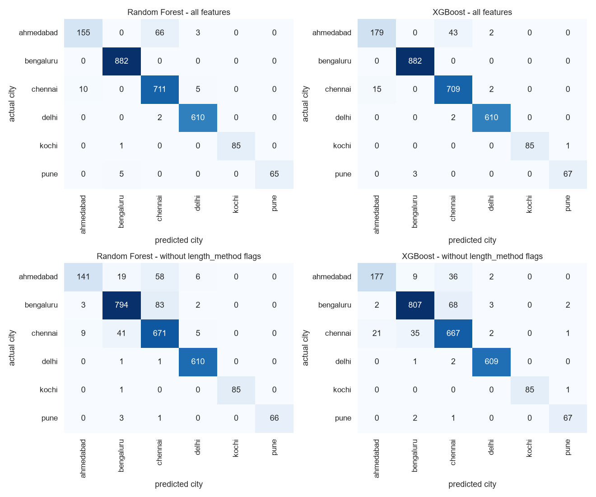
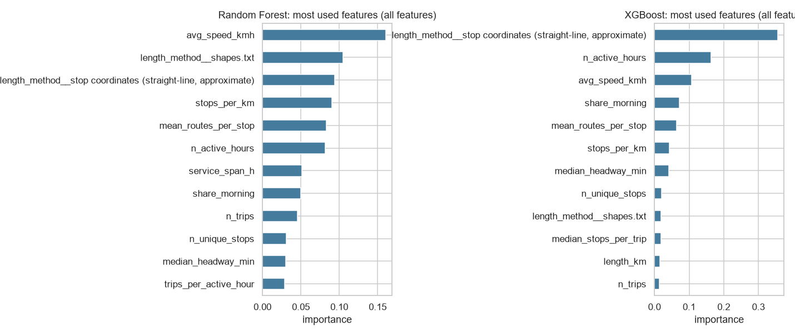

# Module 5 - Classification report (Random Forest and XGBoost)

_Generated 2026-11-07._

## Why the target is the city, and why not a performance label

Classification needs labels. GTFS contains no passenger data, so any label like 'overcrowded', 'underutilised' or 'high demand' would be an assumption, and the mentor's rules forbid unsupported labels. **No such label was created.** The only real, observed label in the data is the **city** a route belongs to. Predicting it is a *diagnostic*: if routes of different cities can easily be told apart from their scheduled-service features alone, the feeds have their own 'signature' (different data sources, conventions or generated timetables) and are **not directly comparable**. This says nothing about route performance.

## Setup

* Training: 10,466 routes; validation: 2,600 routes (the grouped 80:20 split of Module 4, so variants of one bus line never sit on both sides). Classes: ahmedabad, bengaluru, chennai, delhi, kochi, pune.
* Features: the 25 Module-4 features (no identifiers, city is only the target). Because `length_method` mostly records whether a feed has shapes.txt (a property of the feed), a second run **without** the length_method columns is reported too.
* Imbalance (Bengaluru is the largest class, Pune the smallest): class weights (Random Forest) and balanced sample weights (XGBoost); the main score is **macro F1**, which treats every city equally.
* Tuning: small grids evaluated with 3-fold grouped cross-validation on the training routes only; the validation set was used once, for the final numbers (no leakage).
* Baseline: always predicting the largest city gives accuracy 0.339 and macro F1 near 0.

## Results on the validation routes

| variant | model | best_params | cv_macro_f1 | accuracy | precision_macro | recall_macro | f1_macro |
|---|---|---|---|---|---|---|---|
| all features | Random Forest | {'n_estimators': 200, 'max_depth': 16, 'min_samples_leaf': 2} | 0.95 | 0.96 | 0.97 | 0.93 | 0.95 |
| all features | XGBoost | {'n_estimators': 400, 'max_depth': 6, 'learning_rate': 0.05} | 0.96 | 0.97 | 0.97 | 0.95 | 0.96 |
| without length_method flags | Random Forest | {'n_estimators': 200, 'max_depth': None, 'min_samples_leaf': 2} | 0.92 | 0.91 | 0.94 | 0.90 | 0.91 |
| without length_method flags | XGBoost | {'n_estimators': 200, 'max_depth': 6, 'learning_rate': 0.1} | 0.94 | 0.93 | 0.94 | 0.93 | 0.93 |

Best parameters were chosen by cross-validated macro F1 (see `tables/module5_classification_tuning.csv`).

### Per-city precision, recall and F1 (XGBoost, all features)

| class | precision | recall | f1 | support |
|---|---|---|---|---|
| ahmedabad | 0.92 | 0.80 | 0.86 | 224 |
| bengaluru | 1.00 | 1.00 | 1.00 | 882 |
| chennai | 0.94 | 0.98 | 0.96 | 726 |
| delhi | 0.99 | 1.00 | 0.99 | 612 |
| kochi | 1.00 | 0.99 | 0.99 | 86 |
| pune | 0.98 | 0.96 | 0.97 | 70 |

*Rows = actual city, columns = predicted city. Numbers off the diagonal are routes the model confused; they show which feeds look alike.*

*Feature importance shows which features the trees used most to separate the cities.*

## Reading the results

* With all features, Random Forest reaches accuracy 0.96 (macro F1 0.95) and XGBoost 0.97 (macro F1 0.96), far above the majority baseline of 0.34.
* Without the length_method flags, accuracy is 0.91 (Random Forest) and 0.93 (XGBoost), so the cities are distinguishable even from the service features alone, i.e. **the feeds carry their own fingerprint**.
* Consequence for the project: pooling all cities in one clustering is only partly meaningful; clusters should be checked per city (the cluster composition chart in the clustering report) and conclusions should not compare raw trip counts across cities.
* A high score here is *not* a sign of a good route model. It is a sign that the cities differ in how their schedules are written.

## Limitations

* The target is not a transport-planning quantity; the models are not usable to judge routes.
* Small classes (Pune, Kochi) have few validation routes, so their per-city scores vary a lot.
* Feature importance of trees shows use, not cause.