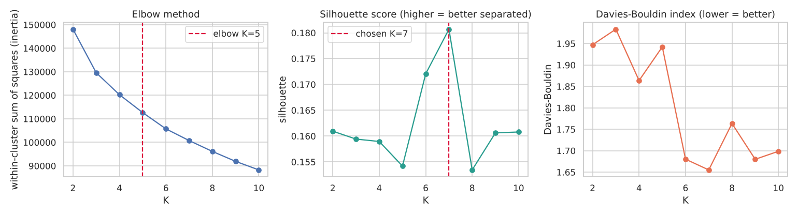
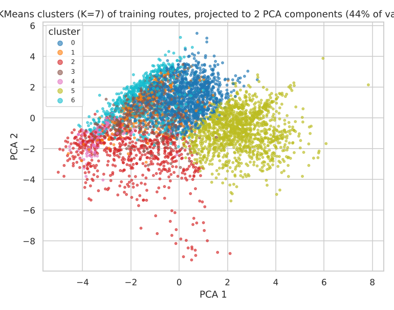
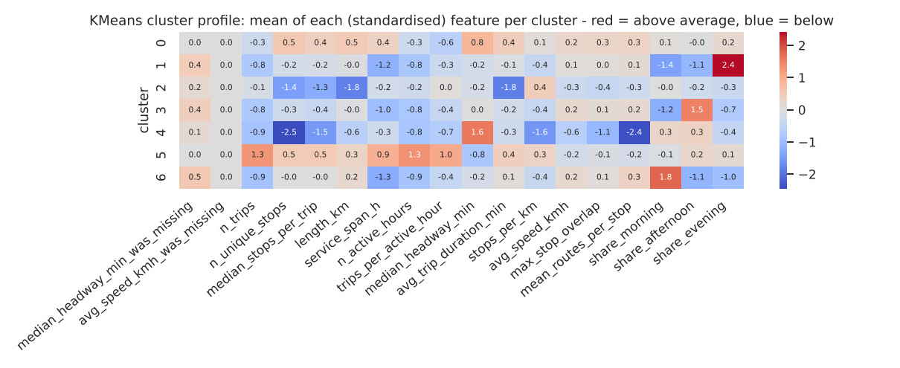
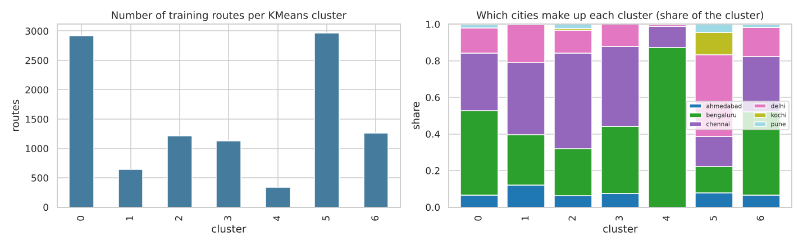
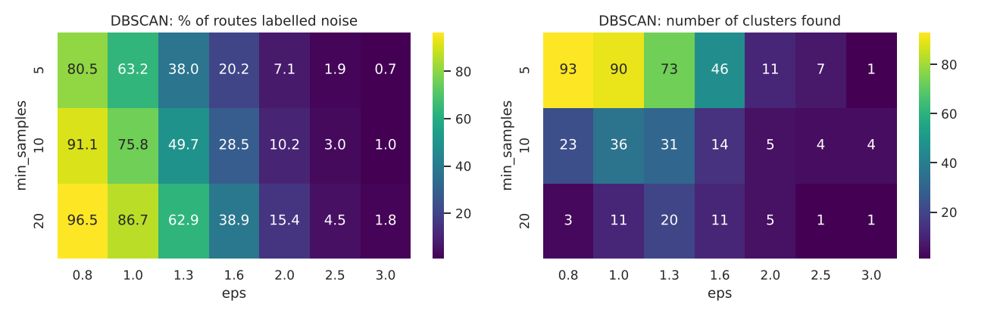
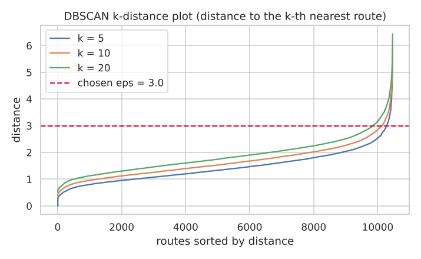
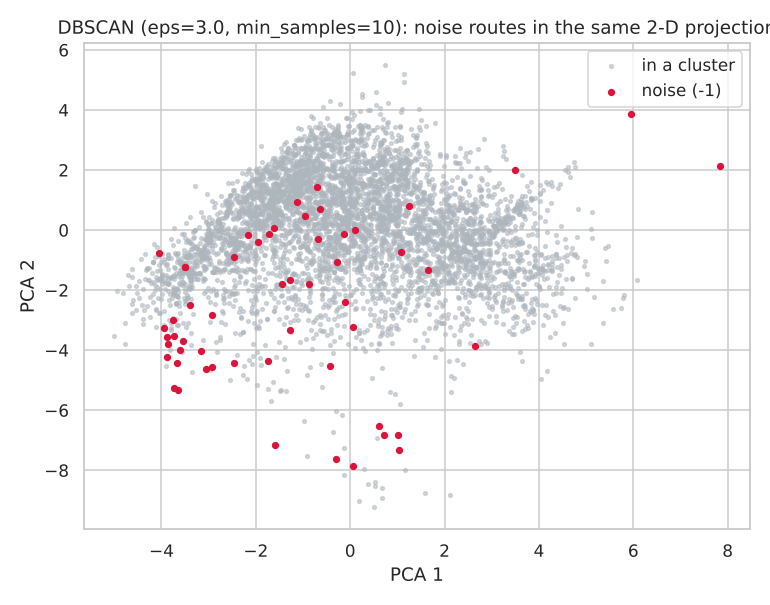

# Module 5 - Clustering report (KMeans and DBSCAN)

_Generated 2026-11-07._ Data: Module-4 preprocessed routes (10,466 training, 2,600 validation; 25 standardised features; Hyderabad excluded in Module 4). **A cluster is a group of routes with similar *scheduled* service - not a performance class and not an optimisation recommendation.** GTFS has no passenger data, so nothing here says that a route is overcrowded or underutilised.

## How the algorithms work (short)

* **KMeans:** choose K; place K centroids; assign each route to its nearest centroid; move each centroid to the mean of its routes; repeat until assignments stop changing. Needs scaled features (done in Module 4) because it uses Euclidean distance.
* **DBSCAN:** a route is a *core point* if at least `min_samples` routes lie within distance `eps`; clusters grow by connecting core points and their neighbours; routes that belong to no dense region are *noise* (-1). No K is needed.

## KMeans

### Choosing K (training routes, K = 2..10)

| k | inertia | silhouette | davies_bouldin | smallest_cluster_share |
|---|---|---|---|---|
| 2 | 148,096.37 | 0.16 | 1.95 | 0.37 |
| 3 | 129,587.86 | 0.16 | 1.98 | 0.24 |
| 4 | 120,256.56 | 0.16 | 1.86 | 0.13 |
| 5 | 112,653.01 | 0.15 | 1.94 | 0.12 |
| 6 | 105,741.16 | 0.17 | 1.68 | 0.08 |
| 7 | 100,755.68 | 0.18 | 1.66 | 0.03 |
| 8 | 96,146.86 | 0.15 | 1.76 | 0.03 |
| 9 | 91,915.62 | 0.16 | 1.68 | 0.03 |
| 10 | 88,279.30 | 0.16 | 1.70 | 0.03 |

* **Elbow method:** the inertia curve bends most at K = 5.
* **Silhouette:** the values are low for every K (0.15-0.18); the highest is K = 7. Low scores mean the routes form a continuum rather than clearly separated groups.
* **Davies-Bouldin:** lowest (best) at K = 7 (1.66).
* **Decision:** K = **7** (best silhouette for K in 3-8 with no cluster smaller than 2% of the routes). The elbow K = 5 and K = 3 (the mentor's example) give similar quality, so the choice is a convenience for interpretation, not a sharp optimum.
* **Stability** (adjusted Rand index between runs with different random starts, 1 = identical): K=3: 0.99, K=5: 0.95, K=7: 0.98.

### Final KMeans (K = 7)

Silhouette: training 0.181, validation 0.180. Davies-Bouldin: training 1.66, validation 1.66. Validation routes are assigned to the nearest training centroid, so a similar validation score means the clusters generalise to routes they were not built on.

*Each dot is a route; the 25 features are projected to 2 dimensions only for drawing, so clusters that overlap in the picture can still differ in other features.*

### What each cluster looks like (medians in original units)

| cluster | n_trips | n_unique_stops | length_km | service_span_h | trips_per_active_hour | median_headway_min | avg_speed_kmh | max_stop_overlap | mean_routes_per_stop | share_morning | share_afternoon | share_evening | routes |
|---|---|---|---|---|---|---|---|---|---|---|---|---|---|
| 0 | 5.00 | 48.00 | 24.99 | 11.58 | 1.00 | 122.50 | 19.28 | 0.76 | 70.53 | 0.50 | 0.25 | 0.25 | 2918 |
| 1 | 2.00 | 28.00 | 17.17 | 0.75 | 1.00 | 35.00 | 17.82 | 0.67 | 57.39 | 0.00 | 0.00 | 1.00 | 645 |
| 2 | 6.00 | 9.00 | 4.03 | 9.33 | 1.33 | 37.50 | 16.57 | 0.50 | 44.67 | 0.41 | 0.20 | 0.00 | 1211 |
| 3 | 2.00 | 25.00 | 15.81 | 1.33 | 1.00 | 55.00 | 19.16 | 0.69 | 61.13 | 0.00 | 0.82 | 0.00 | 1129 |
| 4 | 2.00 | 2.00 | 10.79 | 8.33 | 1.00 | 498.00 | 16.35 | 0.33 | 8.00 | 0.50 | 0.50 | 0.00 | 334 |
| 5 | 34.00 | 45.00 | 21.89 | 15.33 | 2.20 | 24.00 | 15.03 | 0.64 | 50.02 | 0.41 | 0.30 | 0.24 | 2971 |
| 6 | 1.00 | 31.00 | 19.27 | 0.00 | 1.00 | 40.00 | 19.11 | 0.68 | 69.55 | 1.00 | 0.00 | 0.00 | 1258 |

Most distinctive features of each cluster (mean standardised value; + = above the overall average):

| cluster | routes | share_of_train | most_distinctive_features_z |
|---|---|---|---|
| 0 | 2918 | 27.9% | peak_period__morning (+0.84), median_headway_min (+0.82), trips_per_active_hour (-0.57) |
| 1 | 645 | 6.2% | share_evening (+2.42), share_morning (-1.42), service_span_h (-1.18) |
| 2 | 1211 | 11.6% | avg_trip_duration_min (-1.85), length_km (-1.83), n_unique_stops (-1.45) |
| 3 | 1129 | 10.8% | share_afternoon (+1.49), share_morning (-1.22), service_span_h (-0.98) |
| 4 | 334 | 3.2% | n_unique_stops (-2.45), mean_routes_per_stop (-2.38), median_headway_min (+1.6) |
| 5 | 2971 | 28.4% | n_active_hours (+1.31), n_trips (+1.27), trips_per_active_hour (+1.02) |
| 6 | 1258 | 12.0% | share_morning (+1.79), service_span_h (-1.28), share_afternoon (-1.13) |

*Cluster composition by city shows whether a cluster is a real service pattern or mostly one feed: cluster 0: bengaluru 46%; cluster 1: chennai 40%; cluster 2: chennai 52%; cluster 3: chennai 44%; cluster 4: bengaluru 87%; cluster 5: delhi 44%; cluster 6: bengaluru 46%.*

## DBSCAN

### Parameter experiments (eps x min_samples)

| eps | min_samples | clusters | noise_pct | largest_cluster_share | silhouette_non_noise |
|---|---|---|---|---|---|
| 0.80 | 5 | 93 | 80.50 | 0.03 | 0.17 |
| 1.00 | 5 | 90 | 63.20 | 0.10 | 0.04 |
| 1.30 | 5 | 73 | 38.00 | 0.20 | -0.10 |
| 1.60 | 5 | 46 | 20.20 | 0.68 | -0.31 |
| 2.00 | 5 | 11 | 7.10 | 0.91 | -0.00 |
| 2.50 | 5 | 7 | 1.90 | 0.97 | 0.15 |
| 3.00 | 5 | 1 | 0.70 | 0.99 |  |
| 0.80 | 10 | 23 | 91.10 | 0.02 | 0.37 |
| 1.00 | 10 | 36 | 75.80 | 0.07 | 0.22 |
| 1.30 | 10 | 31 | 49.70 | 0.17 | 0.09 |
| 1.60 | 10 | 14 | 28.50 | 0.62 | -0.19 |
| 2.00 | 10 | 5 | 10.20 | 0.88 | -0.02 |
| 2.50 | 10 | 4 | 3.00 | 0.97 | 0.24 |
| 3.00 | 10 | 4 | 1.00 | 0.98 | 0.30 |
| 0.80 | 20 | 3 | 96.50 | 0.01 | 0.79 |
| 1.00 | 20 | 11 | 86.70 | 0.04 | 0.42 |
| 1.30 | 20 | 20 | 62.90 | 0.14 | 0.13 |
| 1.60 | 20 | 11 | 38.90 | 0.28 | 0.08 |
| 2.00 | 20 | 5 | 15.40 | 0.82 | -0.01 |
| 2.50 | 20 | 1 | 4.50 | 0.95 |  |
| 3.00 | 20 | 1 | 1.80 | 0.98 |  |

*Small eps labels most routes as noise (many tiny clusters); large eps merges nearly everything into one cluster. The k-distance plot shows the distance scale of the data: the 'knee' marks where routes stop having close neighbours.*

**Decision:** eps = **3.0**, min_samples = **10** (best silhouette of the non-noise routes among settings with at least 2 clusters and 1-15% noise).

### Final DBSCAN

* Clusters found: **4**; the largest holds 99% of the training routes.
* Noise: **1.0%** of training routes and **1.0%** of validation routes (validation routes are noise when no training core point is within eps).
* Silhouette of the non-noise routes: 0.302; Davies-Bouldin: 0.99.
* **Reading:** with these features DBSCAN finds one large dense region plus a few small groups, so it is not a good *segmentation* tool here; its value is **finding unusual routes**.

### Noise-point analysis (noise is not an error)

| city | noise_routes | share |
|---|---|---|
| ahmedabad | 11 | 0.01 |
| bengaluru | 97 | 0.02 |
| chennai | 15 | 0.00 |
| delhi | 4 | 0.00 |
| kochi | 0 | 0.00 |
| pune | 3 | 0.01 |

Median features of noise routes versus all other routes:

| feature | noise routes (median) | other routes (median) |
|---|---|---|
| n_trips | 4.00 | 6.00 |
| n_unique_stops | 5.00 | 36.00 |
| length_km | 4.92 | 19.26 |
| service_span_h | 8.08 | 10.42 |
| trips_per_active_hour | 1.58 | 1.00 |
| median_headway_min | 20.00 | 52.50 |
| avg_speed_kmh | 13.86 | 17.90 |
| max_stop_overlap | 0.44 | 0.67 |
| mean_routes_per_stop | 17.70 | 56.82 |
| share_morning | 0.35 | 0.43 |
| share_afternoon | 0.25 | 0.29 |
| share_evening | 0.01 | 0.20 |

Features that push routes out of the dense region (mean standardised value of noise routes): avg_trip_duration_min (-1.7), n_unique_stops (-1.6), mean_routes_per_stop (-1.2), median_stops_per_trip (-1.0), length_km (-0.8).

All 130 noise routes (training and validation) are listed in `tables/module5_dbscan_noise_routes.csv`. Before calling any of them wrong, check whether it is (a) a data problem (e.g. invalid speed - 51 noise routes have no valid scheduled speed), (b) a special service (very long or very many stops) or (c) just a rare combination of normal values.
