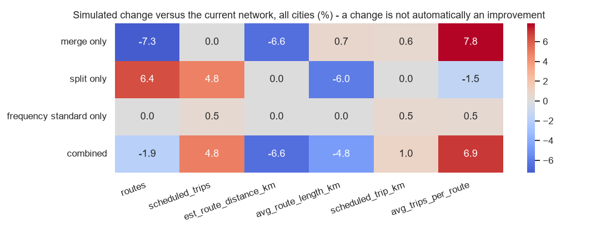
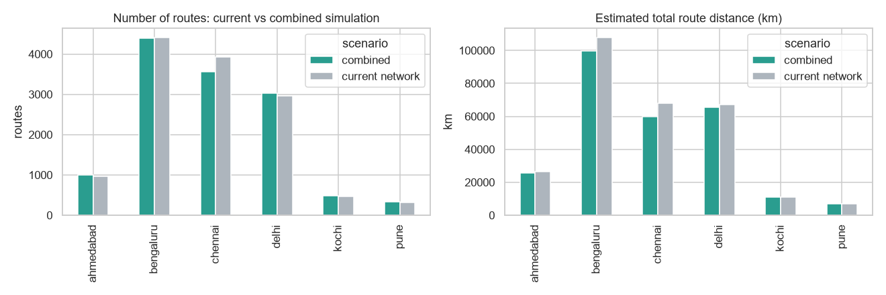

# Module 6 - Current versus simulated network

_Generated 2026-11-19._ The simulation changes **a copy** of the route table (`data/simulated/simulated_network.csv`); the original data is untouched. Current and simulated metrics use the **same definitions and the same schedule period**. All simulated numbers are **what-if results, not forecasts**.

## Assumptions of the simulation

* **Merge:** the absorbed route's departures are **kept** (no trips removed); the merged route gets the unshared part of the absorbed route (length x (1 - shared-stop share)) and its stops; the absorbed route disappears.
* **Split:** the route is cut at its middle stop into two routes of half the length; **each part keeps all original departures**, so scheduled trip-km stays the same while the number of trip records doubles; transfer burden is ignored.
* **Frequency:** trips are added until the busiest hour has 2 departures (a 30-minute headway standard).
* **Combined:** all three, with precedence merge > split > frequency (a route is changed once).
* The unique stops served do not change in any scenario (every stop stays on some route), so **stop coverage is preserved by construction**; geographical coverage and passenger access could not be measured.

## Network metrics (all comparable cities)

| scenario | routes | scheduled_trips | est_route_distance_km | avg_route_length_km | scheduled_trip_km | avg_trips_per_route | routes_over_40km | routes_with_under_2_departures_in_peak_hour |
|---|---|---|---|---|---|---|---|---|
| current network | 13,066 | 223,422 | 287,533.70 | 22.01 | 4,877,004.70 | 17.10 | 1,029 | 1,098 |
| merge only | 12,117 | 223,422 | 268,632 | 22.17 | 4,905,070.40 | 18.44 | 966 |  |
| split only | 13,904 | 234,123 | 287,533.70 | 20.68 | 4,877,004.70 | 16.84 | 319 |  |
| frequency standard only | 13,066 | 224,520 | 287,533.70 | 22.01 | 4,902,545.40 | 17.18 | 1,029 | 0 |
| combined | 12,815 | 234,242 | 268,632 | 20.96 | 4,925,161.20 | 18.28 | 396 |  |

*Metric definitions:* routes = number of routes; scheduled trips = number of scheduled trips (trip records); est. route distance = sum of estimated route lengths; scheduled trip-km = sum of trips x route length (scheduled vehicle-kilometres); the last column counts routes with >= 6 trips but < 2 departures in their busiest hour (only meaningful for the current network and the frequency scenario, because merging and splitting change what 'busiest hour' means).

## Reading the comparison

* **Merging** reduces the number of routes by 949 (-7.3%) and the estimated route distance by 6.6%, with scheduled trips unchanged. Because the merged route is longer and runs all departures, scheduled trip-km rises by 0.6%.
* **Splitting** leaves the estimated total distance and the scheduled trip-km unchanged, adds 838 routes and 10,701 trip records, and cuts the number of routes longer than 40 km from 1,029 to 319. Its benefit (shorter routes, easier management) is operational and cannot be measured here.
* **The frequency standard** adds 1,098 scheduled trips (0.5%) and brings routes with fewer than 2 departures in the busiest hour from 1,098 to 0.
* **Combined:** 12,815 routes (from 13,066), 234,242 scheduled trips (from 223,422), estimated distance 268,632 km (from 287,534 km).

**Important:** fewer routes or less distance does **not** mean a better network. Passenger access, geographical coverage, travel times and demand were not measured; the table shows only what these *assumptions* do to the *schedule*.

## What would be needed to judge the impact

* Boardings per route, stop and time period, matched to the GTFS route ids and dates.
* Vehicle capacity and fleet availability.
* Travel-time data and transfer volumes (for splits), and the operator's purpose for each route.
* Validated route shapes for every route to measure real overlap and coverage.

## By city

| scenario | city | routes | scheduled_trips | est_route_distance_km | avg_route_length_km | scheduled_trip_km | avg_trips_per_route |
|---|---|---|---|---|---|---|---|
| combined | ahmedabad | 1000 | 15518 | 25,679.10 | 25.68 | 399,231.80 | 15.52 |
| current network | ahmedabad | 972 | 14323 | 26,482.50 | 27.25 | 395,247.20 | 14.74 |
| combined | bengaluru | 4399 | 61042 | 99,766 | 22.68 | 1,223,914.60 | 13.88 |
| current network | bengaluru | 4416 | 57836 | 107,987.70 | 24.45 | 1,198,317.60 | 13.10 |
| combined | chennai | 3564 | 48382 | 59,970.30 | 16.83 | 916,832 | 13.58 |
| current network | chennai | 3934 | 47047 | 67,966.40 | 17.28 | 905,685.10 | 11.96 |
| combined | delhi | 3024 | 82077 | 65,492.20 | 21.66 | 1,807,222.70 | 27.14 |
| current network | delhi | 2964 | 78507 | 67,190.70 | 22.67 | 1,801,566.70 | 26.49 |
| combined | kochi | 490 | 16427 | 10,821.30 | 22.08 | 362,658.40 | 33.52 |
| current network | kochi | 465 | 15581 | 10,821.30 | 23.27 | 362,357.10 | 33.51 |
| combined | pune | 338 | 10796 | 6,903.10 | 20.42 | 215,301.50 | 31.94 |
| current network | pune | 315 | 10128 | 7,085.10 | 22.49 | 213,831 | 32.15 |
