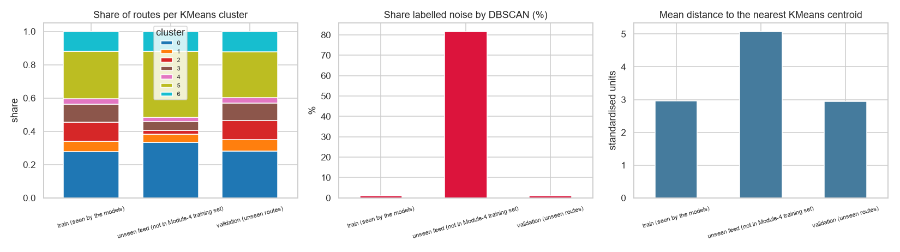
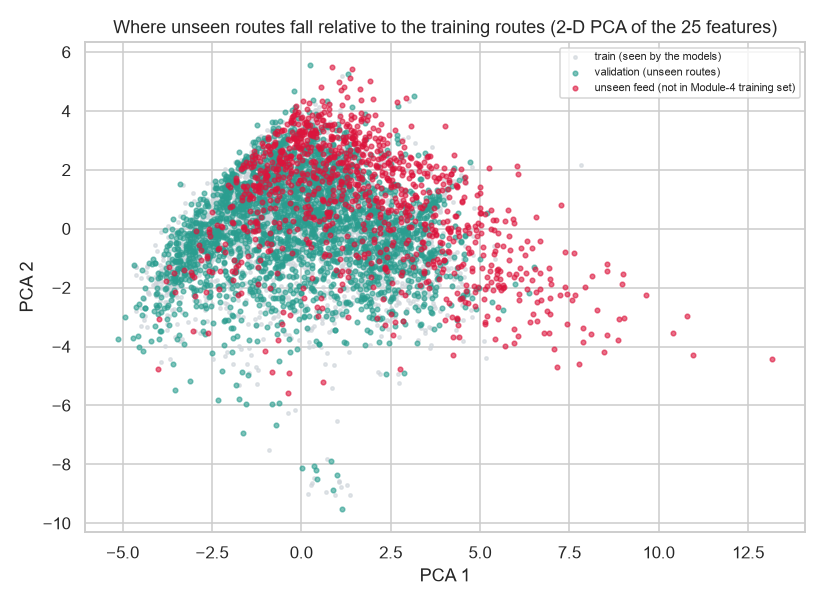

# Module 6 - Inference report

_Generated 2026-11-19._ Inference = applying the **already trained** Module-5 models to routes, with the **same preprocessing objects** that were fitted in Module 4 (nothing is re-fitted).

## What is what

| kind | examples | status |
|---|---|---|
| Actual data | route_features.csv values (trips, stops, headway ...), taken from the GTFS schedule | scheduled; not passenger data |
| Model predictions | KMeans cluster, DBSCAN label (cluster / noise), closest known feed (XGBoost) | outputs of models trained in Module 5; not facts |
| Estimates | route length from stops or shapes, evidence flags, 'unshared length' after a merge | derived with stated rules |
| Simulated results | everything in data/simulated/ and in the current-vs-simulated tables | what-if scenarios under stated assumptions |

## Workflow

1. Load the saved models (`models/`) and preprocessing objects (`models/preprocessor.joblib`).
2. Take new / unseen route records (`data/inference/unseen_routes.csv`; any table with the Module-2 route feature columns works: `python run_module6.py --input <file>`); the columns are checked.
3. Apply the fitted preprocessor (derived columns, median imputation, log, standardisation, one-hot) - **no new scaler or encoder is fitted**.
4. KMeans: nearest centroid. DBSCAN: nearest core point within eps, otherwise noise (-1). XGBoost: closest known feed.
5. Analyse the outputs (below) and generate suggestions (next report).

**Consistency check:** the saved preprocessor re-applied to the 2,600 validation routes reproduces the stored Module-4 validation table (largest difference 1.8e-15), so inference uses exactly the training-time preprocessing.

## Unseen data used

* **Validation routes (2,600)** were held out in Module 4 and never used to fit the models.
* **An unseen feed:** Hyderabad (1,031 routes) was excluded from the Module-4 training set because its trips look like whole vehicle duties.
* The training routes are scored too, only as a reference (they were seen by the models).

## Results by data role

| data_role | routes | dbscan_noise_pct | mean_distance_to_centroid | mean_closest_feed_probability |
|---|---|---|---|---|
| train (seen by the models) | 10466 | 1 | 2.96 | 0.97 |
| unseen feed (not in Module-4 training set) | 1031 | 81.70 | 5.08 | 0.87 |
| validation (unseen routes) | 2600 | 1 | 2.94 | 0.96 |

* **Validation routes behave like the training routes:** the same share is noise (1.0% vs 1.0%) and the distance to the nearest centroid is almost identical, so the models generalise to routes they did not see.
* **The unseen feed does not fit:** 81.7% of Hyderabad routes are DBSCAN noise (training: 1.0%) and their mean distance to a centroid is 5.08 (training: 2.96). This supports the Module-3/4 finding that this feed is **not comparable** with the others; it is **not** evidence that its routes are inefficient or wrong. Its routes are therefore **not used for suggestions**.
* XGBoost's 'closest known feed' for Hyderabad is ahmedabad (547), chennai (484); the label only says which known feed's schedule features they resemble most.

## What the KMeans clusters mean (scheduled service only)

| cluster | description (from the Module-5 median profile) |
|---|---|
| 0 | mixed-day, mid-range service |
| 1 | very few scheduled trips; mostly evening departures |
| 2 | relatively many scheduled trips |
| 3 | very few scheduled trips; mostly afternoon departures |
| 4 | very few scheduled trips; very short route (few stops) |
| 5 | relatively many scheduled trips |
| 6 | very few scheduled trips; mostly morning departures |

Cluster numbers are not rankings. Clusters 1, 3, 4 and 6 are groups of routes with very few scheduled trips; that is a description of the timetable, not a verdict.

## Files

* `data/inference/unseen_routes.csv` - the unseen route records.
* `data/inference/inference_predictions.csv` - one row per route: KMeans cluster and description, distance to centroid, DBSCAN label and distance to nearest core point, closest known feed and probability.
