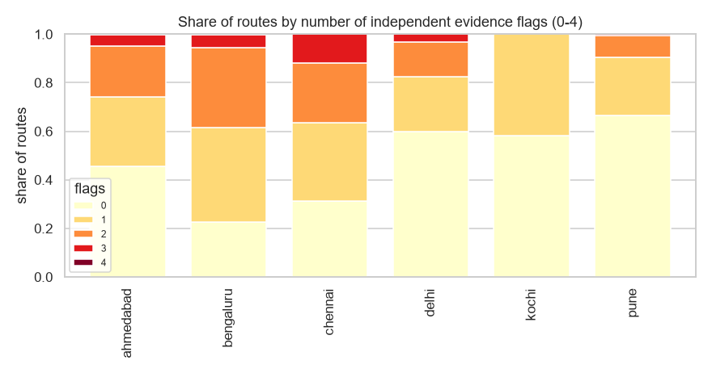

# Module 6 - Routes to investigate and optimisation suggestions

_Generated 2026-11-19._ **Candidates, not conclusions.** No passenger demand, capacity or crowding data exists in GTFS, so no route is called inefficient. Suggestions come from schedule and geography (shared stops) only and each lists what must be verified first.

## 1. Routes that may need further investigation

A route is listed only when **at least two independent pieces of evidence** agree (never one feature or one cluster alone). Evidence: unusual for DBSCAN (noise), in a KMeans cluster of very few trips, shares >= 80% of its stops with another route, few trips compared with routes of similar length. Routes of the unseen feed (hyderabad) are excluded because the feed is not comparable.

| city | 0 | 1 | 2 | 3 | 4 |
|---|---|---|---|---|---|
| ahmedabad | 444 | 276 | 203 | 47 | 2 |
| bengaluru | 1005 | 1719 | 1440 | 243 | 9 |
| chennai | 1225 | 1268 | 977 | 464 | 0 |
| delhi | 1776 | 664 | 428 | 96 | 0 |
| kochi | 270 | 195 | 0 | 0 | 0 |
| pune | 210 | 75 | 28 | 2 | 0 |

* **3,939 routes** have at least 2 flags and **863** have 3 or 4 (`tables/module6_investigation_candidates.csv`, with the reasons for each). These are where a planner should look first - together with ridership data.
* **121 routes** have an impossible scheduled speed (length or timetable unreliable): check the **data** before anything else.

Examples with the most evidence:

| city | route_name | n_evidence | why_listed | n_trips | n_unique_stops | length_km |
|---|---|---|---|---|---|---|
| ahmedabad | 66/3sh | 4 | unusual for DBSCAN (noise); in a KMeans cluster of very few trips; shares >= 80% of its stops with another route; few trips compared with routes of similar length | 1 | 90 | 157.44 |
| ahmedabad | 109 | 4 | unusual for DBSCAN (noise); in a KMeans cluster of very few trips; shares >= 80% of its stops with another route; few trips compared with routes of similar length | 3 | 7 | 13.82 |
| bengaluru | NLS-2 | 4 | unusual for DBSCAN (noise); in a KMeans cluster of very few trips; shares >= 80% of its stops with another route; few trips compared with routes of similar length | 1 | 2 | 8.15 |
| bengaluru | NLS-1 | 4 | unusual for DBSCAN (noise); in a KMeans cluster of very few trips; shares >= 80% of its stops with another route; few trips compared with routes of similar length | 1 | 2 | 8.15 |
| bengaluru | NLS-06 | 4 | unusual for DBSCAN (noise); in a KMeans cluster of very few trips; shares >= 80% of its stops with another route; few trips compared with routes of similar length | 1 | 2 | 8.17 |
| bengaluru | NLS-07 | 4 | unusual for DBSCAN (noise); in a KMeans cluster of very few trips; shares >= 80% of its stops with another route; few trips compared with routes of similar length | 1 | 2 | 8.17 |
| bengaluru | NLS-08 | 4 | unusual for DBSCAN (noise); in a KMeans cluster of very few trips; shares >= 80% of its stops with another route; few trips compared with routes of similar length | 1 | 2 | 8.17 |
| bengaluru | O Test AFCS | 4 | unusual for DBSCAN (noise); in a KMeans cluster of very few trips; shares >= 80% of its stops with another route; few trips compared with routes of similar length | 2 | 79 | 31.04 |

## 2. Route merging

**Rule:** route r is a merge candidate into its best partner p when (a) they have **different line names** and are not opposite directions, (b) their **stop sets are >= 80% similar** (shared stops = geographical connectivity), (c) r is **lightly scheduled** (<= 25th percentile of its city) and (d) their lengths differ by at most 1.5x. Each route is used in at most one merge.

**949 candidate merges** (`tables/module6_merge_suggestions.csv`): ahmedabad 54, bengaluru 301, chennai 489, delhi 98, pune 7. Examples:

| city | absorbed_route | target_route | stop_overlap_jaccard | trips_absorbed | trips_target | length_absorbed_km | length_target_km |
|---|---|---|---|---|---|---|---|
| ahmedabad | 117 | 28 | 1 | 1 | 16 | 6.20 | 6.20 |
| ahmedabad | 51Ri | 51sh | 1 | 1 | 18 | 12.30 | 12.30 |
| ahmedabad | 37sh | 123 | 1 | 1 | 10 | 5.10 | 5.10 |
| ahmedabad | 51sh | 51T | 1 | 1 | 4 | 7.80 | 7.80 |
| ahmedabad | 51Ri | 51sh | 1 | 1 | 18 | 12.60 | 12.60 |
| ahmedabad | 16E | 17E | 1 | 2 | 8 | 5.30 | 5.30 |

No merge candidates in: kochi - in these feeds the scheduled trip counts are so uniform (for example frequency-template feeds) that no route is lightly scheduled relative to its peers.

**Must be verified before merging:** passenger demand on both routes, vehicle capacity, travel time, whether the unshared stops stay covered (the simulation keeps them on the merged route), and whether the routes have different purposes (e.g. express vs local).

## 3. Route splitting

**Rule:** a route is a split candidate when it is **long** (>= 40 km and in the top 9% of its city) and **complex** (>= 30 stops) and its scheduled speed is plausible. **838 candidates** (`tables/module6_split_suggestions.csv`): ahmedabad 84, bengaluru 379, chennai 158, delhi 160, kochi 25, pune 32. Longest examples:

| city | route | length_km | length_method | stops | trips |
|---|---|---|---|---|---|
| bengaluru | V-DIVYA DARSHANA-1A | 164.80 | shapes.txt | 38 | 1 |
| ahmedabad | 66/3sh | 157.40 | stop coordinates (straight-line, approximate) | 90 | 1 |
| bengaluru | 317-BH | 138 | shapes.txt | 122 | 2 |
| ahmedabad | 52 | 136.90 | stop coordinates (straight-line, approximate) | 76 | 3 |
| ahmedabad | 52 | 136.90 | stop coordinates (straight-line, approximate) | 76 | 3 |
| bengaluru | 293-ZA | 135.90 | shapes.txt | 164 | 9 |

Lengths from stop coordinates are straight-line lower bounds, so those routes may be even longer. **Must be verified before splitting:** passenger journeys along the route, where the transfer would be and its burden, travel time, connectivity between the parts.

## 4. Trip-frequency adjustment

**What the data supports:** a *service-standard* check, not a demand-based one. Routes with at least 6 scheduled trips but **fewer than 2 departures in their busiest hour** have a headway above 30 minutes even at their own peak. **1,098 routes** qualify (`tables/module6_frequency_suggestions.csv`); adding one departure in the busiest hour would bring each to a 30-minute headway (1,098 trips in total).

**What it does not support:** the 30-minute standard is **our assumption**, not an operator rule, and nothing here shows that passengers need these trips. **No trip reductions or redistributions are suggested**: without reliable demand data we cannot know which trips are unnecessary, and minimum service levels must be kept.

## Limitations

* Scheduled data only; no ridership, capacity, delays or operating cost.
* Stop-based overlap and straight-line lengths approximate geography; shapes were not used for the suggestions.
* Thresholds (80% overlap, 25th percentile, 40 km, 30 stops, 30-minute standard) are stated rules of thumb and change the counts.
* Hyderabad is excluded; Delhi, Kochi and Pune have near-constant scheduled speeds, so their durations are model timetables.